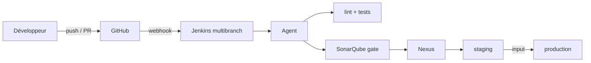

# Skill: Spécification (FR) — TP CI/CD

## Contexte du projet (à connaître avant toute chose)

| Élément | Valeur |
|---------|--------|
| Nature du travail | TP du cours CI/CD (ESGI Master 1 « Information Architecture des Logiciels ») |
| Énoncé de référence | `docs/Projet_CICD_Jenkins.pdf` — **source de vérité**, à lire intégralement |
| Travail | **En solo.** L'exigence « en groupe / trinôme / quadrinôme » de l'énoncé est **ignorée** |
| Application web | **Java / Spring Boot**, build **Maven**, tests **JUnit 5** |
| Outillage | Docker Compose : **Jenkins** (controller + agents), **SonarQube**, **Nexus** |
| Environnements | **staging** et **production**, deux stacks **Docker Compose en local** |
| Règles transverses | Builds sur **agents**, jamais sur le controller · Secrets **uniquement** dans les credentials Jenkins |

## Qu'est-ce que je fais

Je produis la **spécification du TP CI/CD** : un document unique qui part des exigences de l'énoncé,
trouve l'application web à construire et l'architecture de la chaîne, jusqu'aux rendus attendus.

Deux garanties :

1. **Aucune exigence de l'énoncé n'est oubliée** — chacune reçoit un identifiant `EXG-*` tracé dans
   la spécification puis dans les stories.
2. **Aucune décision n'est prise à la place de l'utilisateur** — les choix partent de questions
   posées dans le chat, et chaque réponse est tracée dans le journal des décisions.

## Quand m'utiliser

Au tout début du projet, avant toute ligne de code, pour transformer l'énoncé PDF en spécification
exploitable.

## Workflow

### Étape 0 — Lecture de l'énoncé (nouvelle, obligatoire)

Le PDF n'est pas lisible directement par les modèles : il faut l'extraire en texte.

**Où :** racine du dépôt

**Action :**

```bash
pdftotext -layout docs/Projet_CICD_Jenkins.pdf - | head -100
```

Si `pdftotext` n'est pas installé : `sudo apt install poppler-utils`.

**Résultat attendu :** le texte de l'énoncé (principe, partie commune, modules par niveau, rendus,
barème, soutenance).

Ensuite, je **découpe l'énoncé en exigences numérotées** avec la convention de traçabilité :

| Préfixe | Signification |
|---------|---------------|
| `EXG-COM-*` | partie commune (obligatoire) |
| `EXG-N1a-*` | module N1 « Qualité et retour rapide » |
| `EXG-N1b-*` | module N1 « Releases automatisées » |
| `EXG-N2a-*` | module N2 « Déploiement progressif blue/green » |
| `EXG-N2b-*` | module N2 « Environnements éphémères » |
| `EXG-N3a-*` | module N3 « Environnements as Code » |
| `EXG-N3b-*` | module N3 « Observabilité et DORA » |
| `EXG-REND-*` | rendus attendus (README, rapport technique, soutenance) |

Ces identifiants sont **stables** : ils sont repris tels quels dans les stories et le plan.

### Étape 1 — Initiation

- Créer `docs/specification/` s'il n'existe pas
- Créer `specification.md` avec les sections vides et la matrice `## Exigences du TP` **déjà
  remplie** par l'étape 0
- Créer le `## Journal des décisions` vide
- Aucune donnée n'est inventée : toute incertitude devient `[À_CLARIFIER: ...]`, tout doute devient
  `[À_VALIDER: ...]`

### Étape 2 — Questions de cadrage (dans le chat)

Je pose au maximum **5 questions par lot**, dans le chat, au format :

```text
Question 1 — <sujet>
  a) <option A>  → <conséquence>       (⭐ recommandé : <raison>)
  b) <option B>  → <conséquence>
Réponds avec : 1a, 2b, 3c...
```

Questions types pour ce TP, avec ma recommandation par défaut :

| Sujet | Options | Recommandation par défaut |
|-------|---------|--------------------------|
| **Périmètre des modules** | N1a+N1b+N2a+N3b / N1a+N1b+N2a+N3a / N1a+N1b+N2b+N3a / autre | **N1a + N1b + N2a + N3b** (DORA) : 4 modules dont 1 de niveau 3 — l'équivalent solo de l'exigence « trinôme ». blue/green reste faisable localement ; les environnements éphémères sont les plus lourds |
| **Fonctionnalité de l'app Spring Boot** | une seule fonctionnalité simple et démontrable / CRUD complet / API REST + UI | **Une fonctionnalité simple mais réelle** (ex : gestion de tâches ou de notes) : l'objectif du TP est la chaîne CI/CD, pas l'app |
| **Hébergement Git distant** | GitHub / GitLab / pas de remote | **GitHub** : webhook + statut de PR, gratuit en privé |
| **Versionnement automatique** | `jreleaser` / `maven-release-plugin` / `semantic-release` | **`jreleaser`** : lit les Conventional Commits, calcule la version, génère changelog + tag + notes de version |
| **Build de l'artefact** | image Docker + JAR publié dans Nexus / JAR seul / image seule | **Image Docker**, avec le JAR publié dans le dépôt Maven de Nexus : les deux sont montrables, l'image rend le déploiement réaliste |
| **Notification de build** | e-mail / Discord / Slack | **Discord** : webhook en 3 lignes, pas de configuration serveur |

Les réponses sont **recopiées** dans le `## Journal des décisions` de `specification.md`.

### Étape 3 — Rédaction de la spécification

Mettre à jour `specification.md` :

- Remplacer les `[À_CLARIFIER: ...]` par les réponses
- Documenter les choix d'architecture avec **une raison** chacun (c'est ce qui est noté au
  rapport technique)
- Laisser `[À_VALIDER: ...]` pour ce qui ne pourra être tranché qu'en cours de route (délais,
  Versions à ajuster)

### Étape 4 — Itération

- Relire : reste-t-il des `[À_CLARIFIER]` ou `[À_VALIDER]` ?
- Si oui → nouvelles questions dans le chat (lot suivant)
- Si non → **spécification terminée**

### Étape 5 — Bascule vers les stories

- Annoncer que la spécification est complète
- Indiquer la commande suivante : `/ story-fr docs/specification/specification.md`

## Format de `specification.md`

```markdown
# Spécification — Projet CI/CD avec Jenkins

> TP du cours CI/CD — ESGI Master 1. Travail solo.
> Énoncé : `docs/Projet_CICD_Jenkins.pdf`

## 1. Contexte et objectifs

[Pourquoi ce projet, ce qu'il faut démontrer]

## 2. Périmètre retenu

[Modules choisis, et modules volontairement écartés **avec la raison**]

## 3. Matrice de traçabilité — Exigences du TP

| ID | Exigence de l'énoncé | Story | Statut |
|----|----------------------|-------|--------|
| `EXG-COM-01` | Outillage démarré en une commande (docker-compose.yml) | #001 | ✅ |
| `EXG-COM-02` | Jenkins, SonarQube et Nexus | #001 | ✅ |
| `EXG-COM-03` | Deux environnements staging et production | #006 | ✅ |
| `EXG-COM-04` | Builds sur agents, jamais sur le controller | #002 | ✅ |
| `EXG-N3b-01` | Prometheus et Grafana | #012 | ✅ |

## 4. Spécification de l'application web

[Ce que fait l'app Spring Boot : parcours, endpoints, modèle de données, tests]

## 5. Architecture de la chaîne CI/CD

### 5.1 Composants

| Composant | Rôle | Exposition |
|-----------|------|-----------|
| Jenkins (controller) | orchestration | `localhost:8080` |
| Jenkins agent | exécution des builds | interne |
| SonarQube | analyse qualité + Quality Gate | `localhost:9000` |
| Nexus | dépôt d'artefacts Maven | `localhost:8081` |
| Reverse proxy | aiguillage blue/green | `localhost:8088` |

### 5.2 Flux



### 5.3 Environnements

| Environnement | Adresse | Origine du déploiement | Déclencheur |
|---------------|---------|------------------------|-------------|
| staging | `localhost:8080` | artefact Nexus | push sur `main` |
| production | `localhost:8088` | **le même artefact** | `input` avec `submitter` |

## 6. Exigences techniques détaillées

[Par composant : Jenkinsfile déclaratif, Shared Library taguée, script de déploiement idempotent,
secrets via credentials…]

## 7. Secrets

[Inventaire : quels secrets, où ils sont stockés, comment le pipeline les consomme]

| Secret | Stockage | Consommé par |
|--------|----------|--------------|
| token SonarQube | Jenkins credentials (secret text) | `sonar.login` |
| identifiants Nexus | Jenkins credentials (username/password) | `withCredentials` |

⚠️ Aucun secret n'est écrit dans un fichier versionné.

## 8. Rendus attendus

- `README.md` permettant de tout relancer
- Rapport technique : architecture, choix argumentés, métriques DORA
- Soutenance : démo commit → prod, puis échec bloqué

## 9. Auto-évaluation (barème /20)

| Critère | Points | Mon résultat |
|---------|--------|--------------|
| Partie commune | 6 | |
| Modules (4 modules) | 6 | |
| Fiabilité (reproductibilité, durée, taux de succès) | 2 | |
| Rapport technique et DORA | 3 | |
| Soutenance | 3 | |

## 10. Journal des décisions

- **Décision :** <sujet> → <choix> · Raison : <justification> · Date : <JJ/MM/AAAA>

## 11. Points ouverts

- `[À_VALIDER: ...]`
```

## ✅ Avant de passer à l'étape suivante — vérifications

Avant de lancer `/ story-fr` :

- [ ] `pdftotext` a bien renvoyé le texte de l'énoncé, et j'ai lu **toutes** les exigences
- [ ] La matrice `## Matrice de traçabilité` contient une ligne pour **chaque** exigence de l'énoncé,
      avec un identifiant `EXG-*`
- [ ] `specification.md` ne contient **plus aucun** marqueur `[À_CLARIFIER: ...]`
- [ ] Les points `[À_VALIDER]` restants sont justifiés (non bloquants pour démarrer)
- [ ] Le périmètre des modules est explicite, et les modules écartés sont justifiés
- [ ] L'application web est décrite assez précisément pour qu'un `Jenkinsfile` soit concevable
- [ ] Le tableau des secrets est rempli et **aucun secret n'est en clair**
- [ ] Le `## Journal des décisions` contient la trace de chaque réponse donnée dans le chat
- [ ] L'adresse de staging et celle de production sont distinctes et notées

## Exemple de session

```
/ specification-fr
```

1. Je lance `pdftotext`, j'identifie les exigences, j'écris la matrice `EXG-*` dans `specification.md`
2. Je pose 5 questions de cadrage dans le chat (périmètre, app, remote Git, versionnement, artefact)
3. L'utilisateur répond `1a, 2b, 3a, 4a, 5a`
4. Je complète la spécification, j'ajoute les justifications de choix et le journal des décisions
5. Je vérifie qu'il ne reste aucun `[À_CLARIFIER]`, j'annonce la fin et j'indique `/ story-fr`