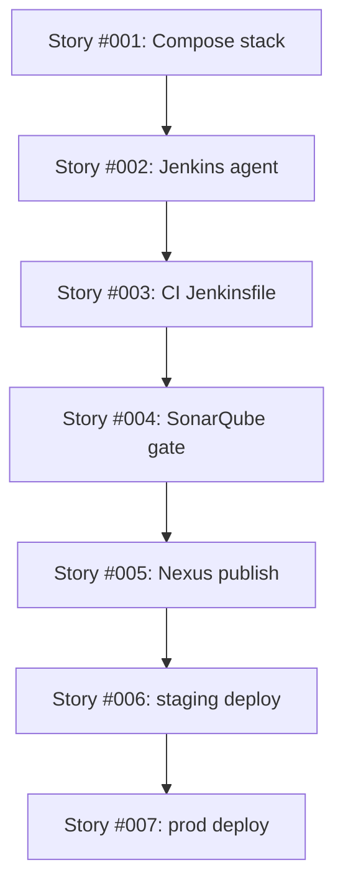

# Skill: Stories (EN) — CI/CD Project

> **Note :** this is the English variant of `story-fr`. The primary skill for this project is
> `story-fr`. Use this variant only if English documentation is explicitly required.

## Project context (read first)

| Item | Value |
|------|-------|
| Nature | CI/CD course assignment (ESGI Master 1) |
| Statement | `docs/Projet_CICD_Jenkins.pdf` |
| Working mode | **Solo** — the statement's group requirement is ignored |
| Stack | Java / Spring Boot + Maven / JUnit 5 |
| Tooling | Docker Compose: Jenkins (controller + agents), SonarQube, Nexus |
| Environments | staging and production, as two local Docker Compose stacks |
| Cross-cutting rules | Builds on **agents**, never on the controller · Secrets **only** in Jenkins credentials |
| Deliverables | Git repos, runnable `README.md`, technical report (architecture, choices, DORA), demo |

## What I do

I split the specification into **CI/CD user stories**, each one:

- **traceable** to a statement requirement (`EXG-*` identifier)
- **verifiable**: acceptance criteria are observable signals (green build, published artifact,
  blocking quality gate, measured duration), not intentions
- **independently executable** by someone discovering the project

I then produce a **sequential solo roadmap** with demonstration milestones.

## When to use me

Once the specification exists (`docs/specification/specification.md`) and you want to break the work
into units.

## Workflow

### Step 1 — Read the specification

- Path given as argument (defaults to `docs/specification/specification.md`)
- Read the specification **and its traceability matrix**
- Create `docs/stories/` if missing
- Generate `story-001.md`, `story-002.md`, …
- **Coverage rule**: every `EXG-*` requirement must be covered by **at least one** story

### Step 2 — Scoping questions (in the chat)

At most **5 questions per batch**, in the chat:

```text
Question 1 — <topic>
  a) <option A>  → <consequence>       (⭐ recommended: <reason>)
  b) <option B>  → <consequence>
Reply with: 1a, 2b, 3c...
```

Typical topics: module scope, automated versioning tool, artifact format, staging/production setup,
Git hosting.

Answers are copied into the `## Decision log` of `plan-implementation.md`.

### Step 3 — Coherence check

- Is each story verifiable and self-contained?
- Are dependencies acyclic?
- Any duplicate or overlap?
- Are file names, YAML keys, ports and versions consistent across stories?
- Does any story bypass the **cross-cutting rules** (build on controller, secret in a file,
  non-idempotent deploy)? If so → fix the story.

### Step 4 — Update

- The user replies in chat (`1a, 2b, …`)
- Update the stories accordingly
- Back to Step 3

### Step 5 — Solo roadmap + completion

- Generate `docs/stories/plan-implementation.md` (format below)
- Announce completion and the next step: `/ tasks-fr <story number>`

### Existing stories

Start directly at Step 3 against `docs/stories/`.

## Story format (story-XXX.md)

```markdown
# Story #XXX: [Title]

**Covered requirements:** `EXG-COM-01`, `EXG-COM-04`

## Context
[Where this story sits in the chain: tooling, CI, CD, module, deliverable]

## Description
As a <role>, I want <action>, so that <benefit>.

**Possible roles:** Developer · CI/CD owner · Pipeline reviewer · Jury member

## Acceptance criteria
Every criterion is an **observable signal**, verifiable by a command or a screenshot.

- [ ] <observable criterion 1>
- [ ] <observable criterion 2>

## Expected evidence
| Evidence | Where | Expected |
|----------|-------|----------|
| Jenkins build | build #N | `Finished: SUCCESS` |
| Test report | `Test` stage | 0 failures, 0 errors |
| Artifact | Nexus `maven-releases` | version `X.Y.Z-<sha>` present |
| Verification command | `curl -s -o /dev/null -w "%{http_code}\n" <url>` | `200` |

## Automated tests
- **Unit:** <what `./mvnw -B test` must cover>
- **Integration:** <what runs with Docker Compose / Testcontainers>
- **Manual:** <UI steps if not automatable>

## Documentation
- [ ] `README.md` — section to create or update
- [ ] `docs/rapport-technique/` — section to feed

## Value for the chain
[Which requirement is satisfied, which grading point is won]

## Dependencies
- Story #XXX (blocking)
- None

## Risks and watch-outs
- [What can fail, and the workaround]

## 📦 Files to commit
- [ ] `path/to/file1`

### Files NOT to commit
| Pattern | Reason |
|---------|--------|
| `.env`, `.env.*` | secrets |
| `secrets/`, `*.pem`, `*.key`, `id_rsa*` | private keys |
| Jenkins credentials | statement requirement: secrets only in Jenkins |
| `target/` | regenerable build output |

⚠️ If any of these shows up in `git status`, **do not commit**. Check `.gitignore`.

## 💬 Commit message
Conventional Commits, **in English** (required by statement module N1):

```
type(scope): description
```

| Type | Use |
|------|-----|
| `feat` | new feature (app or pipeline) |
| `fix` | bug fix |
| `docs` | documentation |
| `test` | tests |
| `build` | `Dockerfile`, `docker-compose.yml`, `pom.xml` |
| `ci` | `Jenkinsfile`, Shared Library, Jenkins/Sonar/Nexus config |
| `chore` | cleanup, tooling |

`scope`: `app`, `jenkins`, `pipeline`, `envs`, `sonar`, `nexus`, `docs`
```

## `plan-implementation.md` format

The work is **solo**, so no parallel groups: a **strictly sequential roadmap** with demonstration
milestones.

```markdown
# Implementation Plan — CI/CD Project

**Context:** solo work. Strictly sequential order.
**Target scope:** common part + 4 modules, including 1 level-3 module (solo equivalent of the "trinôme" requirement).

## Milestones
| Milestone | Content | Expected demo |
|-----------|---------|---------------|
| 0 — Tooling | Docker Compose stack up, Jenkins reachable, SonarQube and Nexus configured | `docker compose ps` → 3 services `Up`; the 3 UIs return `200` |
| 1 — CI | Lint, tests, integration, SonarQube, versioned artifact | A push triggers a green end-to-end build |
| 2 — CD | Auto deploy to staging from `main`, prod after `input` | The same artifact reaches staging then prod |
| 3 — Modules | N1a, N1b, N2a, N3b | Each module demonstrable in 2 min |
| 4 — Deliverables | README, technical report, DORA, demo | Live demo: commit → prod, then a blocked failure |

## Implementation order
| # | Story | Title | Requirements | Time | Depends on | Milestone |
|---|-------|-------|--------------|------|-----------|-----------|
| 001 | #001 | Docker Compose stack | `EXG-COM-01` | 2h45 | — | 0 |

## Checkpoints
- [ ] **Milestone 0** validated: the 3 services respond
- [ ] **Milestone 1** validated: end-to-end green build on a push

## Demo preparation
- [ ] **Success** scenario: commit → staging → prod, no manual step before the `input`
- [ ] **Deliberate failure** scenario: a commit violating the Quality Gate is blocked by the pipeline
- [ ] Both scenarios are written in `docs/rapport-technique/soutenance.md` with exact steps
- [ ] Measured pipeline duration: **< 10 min** (module N1a requirement)

## Coverage check
| Requirement | Story | Status |
|-------------|-------|--------|
| `EXG-COM-01` | #001 | ✅ |
| `EXG-N2b-02` | — | ❌ uncovered → story needed |

## Dependency graph


## Decision log
- **Decision:** <topic> → <choice> · Reason: <justification> · Date: <DD/MM/YYYY>
```

## Step 6 — Requirement coverage control

At the end of the workflow, and on every story addition:

1. List every `EXG-*` identifier from the specification matrix
2. Check each one appears in at least one story
3. If a requirement has no story → **create the missing story**
4. Update the "Coverage check" table in `plan-implementation.md`
5. Check the story count matches the announced scope (common part + N modules)

## ✅ Before moving on — verification checklist

Before running the task decomposition:

- [ ] `docs/specification/specification.md` exists with **no** `[TO_CLARIFY: ...]` marker
- [ ] Every `EXG-*` requirement is covered by at least one story
- [ ] Each story has observable acceptance criteria, expected evidence, and a Conventional Commits message
- [ ] `plan-implementation.md` is **strictly sequential** (solo work — no parallel groups)
- [ ] The 5 demonstration milestones are defined
- [ ] The deliberate-failure demo scenario is planned
- [ ] No story depends on a file not yet produced by an earlier story in the chosen order