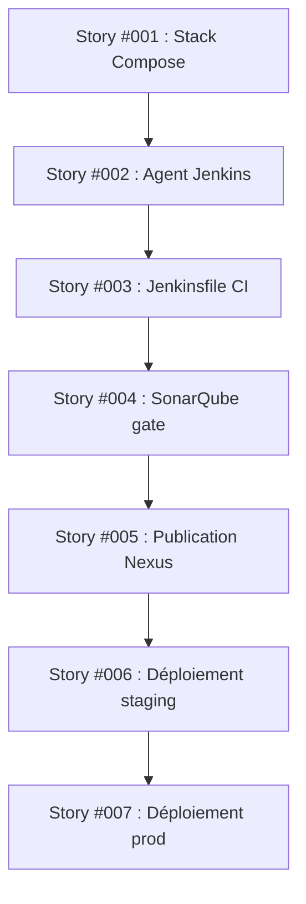

# Skill: Stories (FR) — TP CI/CD

## Contexte du projet (à connaître avant toute chose)

| Élément | Valeur |
|---------|--------|
| Nature du travail | TP du cours CI/CD (ESGI Master 1 « Information Architecture des Logiciels ») |
| Énoncé de référence | `docs/Projet_CICD_Jenkins.pdf` |
| Travail | **En solo.** L'exigence « en groupe / trinôme / quadrinôme » est **ignorée** |
| Application web | **Java / Spring Boot**, build **Maven**, tests **JUnit 5** |
| Outillage | Docker Compose : **Jenkins** (controller + agents), **SonarQube**, **Nexus** |
| Environnements | **staging** et **production**, deux stacks **Docker Compose en local** |
| Règle transverse | Builds sur **agents**, jamais sur le controller. Secrets **uniquement** dans les credentials Jenkins |
| Rendu final | Dépôts Git, `README.md` de relance, rapport technique (architecture, choix, métriques DORA), soutenance |

## Qu'est-ce que je fais

Je découpe la spécification en **user stories** du TP CI/CD, chaque story étant :

- **traçable** à une exigence précise de l'énoncé (identifiant `EXG-*`)
- **vérifiable** : ses critères d'acceptation sont des signaux observables (build vert, artefact
  publié, gate bloquante, durée mesurée), pas des intentions
- **exécutable seule** par un développeur qui découvre le projet

Je produis ensuite une **feuille de route séquentielle** adaptée au travail solo, avec des jalons de
démonstration.

## Quand m'utiliser

Quand la spécification existe (`docs/specification/specification.md`) et que tu veux passer au
découpage en unités de travail.

## Workflow

### Cas 1 — Aucune story n'existe (départ)

**Étape 1 — Lecture de la spécification**

- Chemin de la spécification fourni en argument (ou `docs/specification/specification.md` par défaut)
- Lire la spécification **et sa matrice de traçabilité** `## Exigences du TP`
- Créer `docs/stories/` si inexistant
- Générer les stories avec la numérotation `story-001.md`, `story-002.md`, …
- **Règle de couverture** : chaque exigence `EXG-*` de la matrice doit être couverte par **au moins
  une** story. Une exigence sans story est une lacune, pas un oubli.

**Étape 2 — Questions de cadrage (dans le chat)**

Je pose au maximum **5 questions par lot**, dans le chat, au format :

```text
Question 1 — <sujet>
  a) <option A>  → <conséquence>       (⭐ recommandé : <raison>)
  b) <option B>  → <conséquence>
Réponds avec : 1a, 2b, 3c...
```

Exemples de questions types pour ce TP :

| Sujet | Options | Recommandation par défaut |
|-------|---------|--------------------------|
| Périmètre des modules | N1a+N1b+N2a+N3a / N1a+N1b+N2a+N2b / autre | **N1a + N1b + N2a + N3a** = 4 modules dont 1 de niveau 3, l'équivalent solo de l'exigence trinôme |
| Versionnement auto | `jreleaser` / `maven-release-plugin` / `semantic-release` | **`jreleaser`** : lit les Conventional Commits, calcule la version, génère changelog + tag + notes |
| Environnement d'exécution de l'app | Image Docker (`Dockerfile`) + stack Compose | **Image Docker** : c'est ce qui rend le déploiement par script idempotent crédible |
| Hébergement Git distant | GitHub / GitLab / autre | **GitHub** : webhook + statut de PR standard, et gratuit pour un dépôt privé |

Les réponses sont recopiées dans le `## Journal des décisions` du fichier `plan-implementation.md`.

**Étape 3 — Analyse et vérification de cohérence**

- Chaque story est-elle vérifiable et tenant seule ?
- Les dépendances sont-elles acycliques ?
- Y a-t-il des doublons ou des chevauchements ?
- Les noms de fichiers, clés YAML, ports et versions sont-ils cohérents d'une story à l'autre ?
- Les critères d'acceptation contournent-ils les **exigences transverses** (build sur controller,
  secret dans un fichier, déploiement non idempotent) ? Si oui → corriger la story.

**Étape 4 — Mise à jour**

- L'utilisateur répond dans le chat (`1a, 2b, …`)
- Je mets à jour les stories selon les réponses
- Retour à l'Étape 3

**Étape 5 — Feuille de route solo + fin**

- Quand il n'y a plus rien à clarifier
- Générer `docs/stories/plan-implementation.md` (voir format plus bas)
- Annoncer la fin du workflow et la prochaine étape : `/ tasks-fr 001`

### Cas 2 — Des stories existent déjà

- Démarrer directement à l'Étape 3 avec le chemin `docs/stories/`
- Relire toutes les stories existantes avant d'en ajouter

## Format d'une story (story-XXX.md)

```markdown
# Story #XXX : [Titre]

**Exigences TP couvertes :** `EXG-COM-01`, `EXG-COM-04`

## Contexte

[Où cette story se situe dans la chaîne : outillage, CI, CD, module, rendu]

## Description

En tant que <rôle>, je veux <action>, afin de <bénéfice>.

**Rôles possibles :** Développeur · Responsable CI/CD · Évaluateur de la chaîne · Membre du jury

## Critères d'acceptation

Chaque critère doit être un **signal observable**, vérifiable par une commande ou une capture.

- [ ] <critère observable 1>
- [ ] <critère observable 2>
- [ ] <critère observable 3>

## Preuves attendues

| Preuve | Où la trouver | Attendu |
|--------|---------------|---------|
| Build Jenkins | build n° N | `Finished: SUCCESS` |
| Rapport de tests | stage `Test` | 0 échec, 0 erreur |
| Artefact | dépôt Nexus `maven-releases` | version `X.Y.Z-<sha>` présente |
| Commande de vérification | `curl -s -o /dev/null -w "%{http_code}\n" <url>` | `200` |

## Automatisation des tests

- **Test unitaire :** <ce que `./mvnw -B test` doit couvrir>
- **Test d'intégration :** <ce qui tourne avec Docker Compose / Testcontainers>
- **Recette manuelle :** <manipulation à faire dans l'UI, si non automatisable>

## Documentation

- [ ] `README.md` — section à créer ou mettre à jour
- [ ] `docs/rapport-technique/` — section à alimenter

## Valeur pour la chaîne

[Ce que cette story apporte de démontrable : une exigence satisfaite, un point de barème gagné]

## Dépendances

- Story #XXX (bloquante)
- Aucune

## Risques et points de vigilance

- [Ce qui peut échouer, et le contournement]

## 📦 Fichiers à versionner

- [ ] `chemin/vers/fichier1`
- [ ] `chemin/vers/fichier2`

### Fichiers à NE PAS versionner

| Fichier / motif | Raison |
|------------------|--------|
| `.env`, `.env.*` | secrets |
| `secrets/`, `*.pem`, `*.key`, `id_rsa*` | clés privées |
| Credentials Jenkins | exigence de l'énoncé : secrets uniquement dans Jenkins |
| `*.log` | bruit, données d'exécution |
| `target/`, `node_modules/` | artefacts de build régénérables |

⚠️ Si l'un de ces fichiers apparaît dans `git status`, **ne pas commiter**. Vérifier le `.gitignore`.

## 💬 Message de commit

Conventional Commits, **en anglais** (exigé par le module N1 de l'énoncé) :

```
type(scope): description
```

| Type | Usage |
|------|-------|
| `feat` | nouvelle fonctionnalité (app ou pipeline) |
| `fix` | correction de bug |
| `docs` | documentation |
| `test` | tests |
| `build` | `Dockerfile`, `docker-compose.yml`, `pom.xml` |
| `ci` | `Jenkinsfile`, Shared Library, config Jenkins/Sonar/Nexus |
| `chore` | nettoyage, outillage annexe |

`scope` : `app`, `jenkins`, `pipeline`, `envs`, `sonar`, `nexus`, `docs`
```

## Format de `plan-implementation.md`

Le travail étant **solo**, pas de groupes parallèles : une **feuille de route séquentielle** avec
des jalons de démonstration.

```markdown
# Plan d'implémentation — TP CI/CD

**Contexte :** travail solo. Ordre strictement séquentiel.
**Volume cible :** partie commune + 4 modules dont 1 de niveau 3 (équivalent solo de l'exigence trinôme).

## Jalons

| Jalon | Contenu | Démonstration attendue |
|-------|---------|------------------------|
| 0 — Outillage | Stack Docker Compose up, Jenkins accessible, SonarQube et Nexus configurés | `docker compose ps` → 3 services `Up` ; les 3 UIs répondent en `200` |
| 1 — CI | Lint, tests, intégration, SonarQube, artefact versionné | Un push déclenche un build vert de bout en bout |
| 2 — CD | Déploiement staging auto depuis `main`, prod après `input` | Le même artefact arrive en staging puis en prod |
| 3 — Modules | N1a, N1b, N2a, N3a | Chaque module est démontrable en 2 min |
| 4 — Rendu | README, rapport technique, DORA, soutenance | Démo live : commit → prod, puis échec bloqué |

## Ordre d'implémentation

| # | Story | Titre | Exigences | Temps | Dépend de | Jalon |
|---|-------|-------|-----------|-------|-----------|-------|
| 001 | Story #001 | Stack Docker Compose | `EXG-COM-01` | 2h45 | — | 0 |
| 002 | Story #002 | ... | `EXG-COM-03` | 3h | 001 | 1 |

## Points de contrôle

- [ ] **Jalon 0** validé : les 3 services répondent
- [ ] **Jalon 1** validé : build vert de bout en bout sur un push
- [ ] ...

## Préparation de la soutenance

- [ ] Scénario **succès** : commit → staging → prod, sans intervention manuelle avant l'`input`
- [ ] Scénario **échec volontaire** : un commit qui viole la Quality Gate est bloqué par le pipeline
- [ ] Les deux scénarios sont notés dans `docs/rapport-technique/soutenance.md` avec les étapes exactes
- [ ] Durée cible du pipeline mesurée : **< 10 min** (exigence du module N1a)

## Coverage check

| Exigence | Story(s) | Statut |
|----------|----------|--------|
| `EXG-COM-01` | #001 | ✅ |
| `EXG-N2b-02` | — | ❌ non couverte → story à créer |

## Diagramme de dépendances



## Journal des décisions

- **Décision :** <sujet> → <choix retenu> · Raison : <justification> · Date : <JJ/MM/AAAA>
```

## Étape 6 — Contrôle de couverture des exigences

À la fin du workflow, et à chaque ajout de story :

1. Lister tous les identifiants `EXG-*` de la matrice de `specification.md`
2. Vérifier que chacun apparaît dans au moins une story
3. Si une exigence n'est couverte par aucune story → **créer la story manquante** (ne pas laisser de trou)
4. Mettre à jour le tableau « Coverage check » de `plan-implementation.md`
5. Vérifier que le total des stories correspond au périmètre annoncé (partie commune + N modules)

## ✅ Avant de passer à l'étape suivante — vérifications

Avant de lancer `/ tasks-fr`, l'utilisateur doit pouvoir cocher :

- [ ] `docs/specification/specification.md` existe et ne contient **aucun** marqueur `[À_CLARIFIER: ...]` ni `[À_VALIDER: ...]`
- [ ] La matrice `## Exigences du TP` liste toutes les exigences de l'énoncé avec un identifiant
- [ ] Chaque exigence `EXG-*` est couverte par au moins une story
- [ ] Chaque story a : des critères d'acceptation observables, des preuves attendues, un message de commit Conventional Commits
- [ ] `plan-implementation.md` contient un ordre **strictement séquentiel** (pas de « développement en parallèle » — travail solo)
- [ ] Les 4 jalons de démonstration sont définis
- [ ] Le scénario d'échec volontaire pour la soutenance est prévu
- [ ] Aucune story ne dépend d'un fichier non encore produit par une story antérieure de l'ordre choisi

## Exemple d'utilisation

```
/ story-fr docs/specification/specification.md
```

L'agent lit la spécification et sa matrice, pose les questions de cadrage dans le chat (périmètre
des modules, versionnement, hébergement Git), génère les stories, vérifie la couverture de chaque
`EXG-*`, puis produit la feuille de route solo avec ses jalons de démonstration.