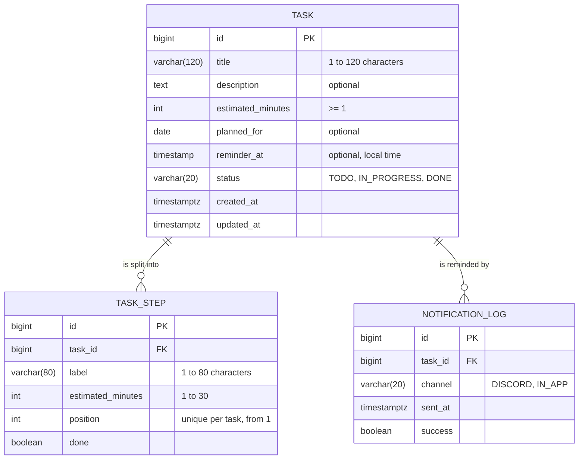

# Data model

The task model of Step by Step (story 008). The schema is created by Flyway
(`src/main/resources/db/migration/V1__create_task_model.sql`); Hibernate only **validates** that the
entities match it (`spring.jpa.hibernate.ddl-auto=validate`).

## Entities

## Constraints

| Rule | Java (Bean Validation) | PostgreSQL |
|------|------------------------|------------|
| Title: 1 to 120 characters | `@NotBlank @Size(max = 120)` | `VARCHAR(120)` + `CHECK` |
| Step label: 1 to 80 characters (`REG-06`) | `@NotBlank @Size(max = 80)` | `VARCHAR(80)` + `CHECK` |
| Step duration: 1 to 30 minutes (`REG-01`) | `@Min(1) @Max(30)` | `CHECK (estimated_minutes BETWEEN 1 AND 30)` |
| Step position unique per task | — | `UNIQUE (task_id, position)` |
| At most one unfinished task per day (`REG-02`) | — (service rule, story 009) | partial unique index on `planned_for` where `status <> 'DONE'` |
| Steps and notifications belong to a task | `@ManyToOne(optional = false)` | `REFERENCES task (id) ON DELETE CASCADE` |

The Java constraints give a readable error before any SQL is sent; the database constraints guard the
data whatever the entry point.

## Tests

| Test | Kind | Database |
|------|------|----------|
| `TaskValidationTest` | unit (Surefire, `./mvnw -B test`) | none |
| `TaskRepositoryIT` | integration (Failsafe) | PostgreSQL 16 from `src/test/resources/compose-test.yml` |
| `StepByStepApplicationIT` | integration (Failsafe): the whole application starts | same |
