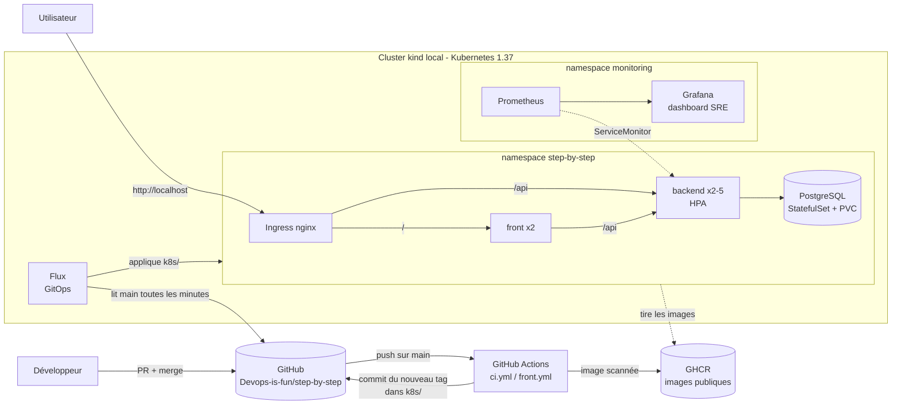

# Dossier de projet — Déploiement continu de Step by Step

**Cours :** DevOps avancé — ESGI M1 (26-27 novembre 2026)
**Équipe :** Géraldine (M1 AL), Morgan (M1 AL), Zhou (M1 IADB)
**Dépôt :** <https://github.com/Devops-is-fun/step-by-step> (public)

---

## 1. L'application

**Step by Step** est une application de gestion de tâches pensée pour les profils TDAH : chaque tâche
est découpée en petites étapes.

| Composant | Technologie | Image |
|---|---|---|
| Frontend | Vue 3 + Vite, servi par nginx non-root | `ghcr.io/devops-is-fun/step-by-step-front:<sha>` |
| Backend | Java 17 / Spring Boot, API REST JSON, Flyway | `ghcr.io/devops-is-fun/step-by-step:<sha>` |
| Base de données | PostgreSQL 16 | `postgres:16.15-alpine3.24` (image officielle) |

Règles métier portées par le backend : **REG-01** (une étape dure de 1 à 30 minutes) et **REG-02**
(une seule tâche non terminée planifiée par jour).

**Pourquoi ce projet :** le sujet préfère un projet existant. Step by Step venait de notre projet CI/CD
(octobre 2026) : application testée (tests unitaires + intégration, couverture ≥ 60 %), déjà conteneurisée,
configuration séparée du code (variables d'environnement), endpoints de santé et de métriques (actuator),
pipeline qualité à transposer plutôt qu'à réinventer. Il manquait un frontend (ajouté par Zhou), une registry,
Kubernetes et le déploiement continu.

---

## 2. Architecture déployée



Avec l'accord du formateur, l'environnement de production est un **cluster Kubernetes local (kind)**
plutôt que deux VM ; la partie Ansible est un bonus.

### Organisation du dépôt (mono-repo)

| Dossier | Contenu |
|---|---|
| `src/`, `pom.xml` | Backend Spring Boot |
| `front/` | Frontend Vue (code, tests, Dockerfile, config nginx) |
| `environments/runtime/Dockerfile` | Image du backend |
| `.github/workflows/` | `ci.yml` (backend), `front.yml` (frontend), `release-please.yml` |
| `k8s/` | **Uniquement des ressources Kubernetes** (appliquées par Flux) |
| `flux/` | Configuration GitOps (source Git + synchronisation de `k8s/`) |
| `scripts/` | Installation reproductible du cluster et outils de test (+ leurs fichiers de config kind/Helm) |
| `docs/` | Documentation (prérequis du cluster, observabilité, API, ce dossier) |

---

## 3. Chaîne de livraison (CI/CD)

```
commit → PR → CI (contrôles) → merge → CI sur main → image → Trivy → GHCR → commit du tag → Flux → rolling update
```

### 3.1 Intégration continue (GitHub Actions)

| Étape | Backend (`ci.yml`) | Frontend (`front.yml`) |
|---|---|---|
| Secrets dans tout l'historique git | gitleaks | — (même dépôt) |
| Lint | checkstyle | oxlint + eslint **sans `--fix`** (`lint:ci`) |
| Tests | unitaires + intégration sur un PostgreSQL de service, couverture ≥ 60 % | Vitest + Testing Library |
| Lint du Dockerfile | Hadolint | Hadolint |
| Build de l'image | le jar testé est emballé (build unique) | build multi-stage |
| Vulnérabilités (CVE) | Trivy, bloquant sur HIGH/CRITICAL corrigeables | Trivy |
| Publication | GHCR, **depuis `main` uniquement**, tags `<sha>` + `latest` | idem |
| Déploiement | commit du nouveau tag dans `k8s/20-app.yaml` | commit du tag dans `k8s/30-front.yaml` |

- Le workflow du frontend ne tourne **que si `front/` change**.
- Sur une PR, l'image est construite et scannée mais **jamais publiée** : une image vulnérable n'atteint pas la registry.
- La configuration CI est entièrement versionnée (YAML).

### 3.2 Registry : GHCR

Intégré à GitHub : la CI publie avec le `GITHUB_TOKEN` automatique (aucun secret à créer).
Les images sont **publiques** : n'importe quel cluster peut les télécharger sans identifiants (portabilité).
Tag = **SHA du commit** : traçabilité commit → pipeline → image, et mises à jour détectées par Kubernetes.

### 3.3 Déploiement continu : GitOps avec Flux (bonus du sujet)

Flux tourne **dans le cluster**, lit la branche `main` toutes les minutes et applique `k8s/`.
La CI ne touche jamais le cluster : elle écrit seulement le nouveau tag dans Git.

- **Avantages :** le cluster *tire* les changements (pas besoin que GitHub joigne un cluster local),
  dépôt public → aucun token pour Flux, Git = source de vérité, retour arrière = `git revert`.
- **Dérive corrigée :** une modification faite à la main avec `kubectl` est annulée à la synchronisation suivante (testé).
- `prune: true` : une ressource retirée de `k8s/` est supprimée du cluster.

---

## 4. Kubernetes

| Ressource | Rôle |
|---|---|
| `Namespace step-by-step` | Isolation de l'application |
| `StatefulSet db` + PVC 1 Gi + Service `db` | PostgreSQL avec stockage persistant |
| `Deployment step-by-step` + Service `app` | Backend : probes startup/liveness/readiness sur l'actuator, requests/limits |
| `Deployment step-by-step-front` + Service `front` | Frontend : 2 pods, `runAsNonRoot`, capabilities retirées |
| `Ingress` | Point d'entrée unique : `/` → front, `/api` → backend ; l'actuator n'est **pas** exposé |
| `HorizontalPodAutoscaler` | Backend de 2 à 5 pods |
| `ServiceMonitor`, ConfigMap du dashboard | Supervision (Prometheus / Grafana) |

**Secrets :** les identifiants de la base sont dans un Secret Kubernetes **créé à la main**, jamais versionné
(dépôt public). La configuration passe par variables d'environnement (`SPRING_DATASOURCE_*`, `API_UPSTREAM`).

**Reproductibilité :** un cluster complet se reconstruit depuis le dépôt :

```bash
./scripts/setup-cluster.sh        # kind (Kubernetes 1.37) + metrics-server
./scripts/install-monitoring.sh   # Prometheus + Grafana (Helm)
./scripts/install-ingress.sh      # ingress-nginx
# namespace + Secret db-credentials
./scripts/install-flux.sh         # Flux déploie ensuite tout k8s/
```

Testé le 27/11 : cluster supprimé puis reconstruit en ~10 minutes, application accessible sur <http://localhost/>.

---

## 5. Contraintes de production

### 5.1 Zéro-downtime

- **Stratégie : rolling update** (`maxSurge: 1`, `maxUnavailable: 0`) : un nouveau pod doit être *prêt*
  (readiness probe) avant qu'un ancien soit arrêté.
- **Arrêt propre :** pause `preStop` de 10 s + `terminationGracePeriodSeconds: 45` (voir difficultés).
- **Base de données :** migrations Flyway *additives* (ex. V2 ajoute une colonne nullable) : les anciens pods
  restent compatibles pendant le rolling update (principe expand/contract).
- **Preuves :** `scripts/test-resilience.sh` (self-healing + 120 requêtes pendant un rolling restart :
  **120/120 après correctif**) et le test k6 (seuil < 1 % d'échecs).

Blue/green (utilisé dans notre projet CI/CD) et canary (Flagger) ont été écartés : le rolling update est
natif à Kubernetes et suffit pour une application sans état côté backend.

### 5.2 Auto-scaling

HPA sur le CPU (cible 70 % de la request de 250m), 2 à 5 pods, descente après 2 minutes de calme.
Le Deployment **ne fixe pas** `replicas`, sinon Flux réimposerait la valeur toutes les minutes.
Test de charge k6 lancé **dans** le cluster (le Service répartit la charge sur tous les pods).

**Mesure du 27/11 :** 2 → 3 → 5 → 4 → 2 pods, 1,7 million de requêtes, 0 % d'erreur, p95 = 4 ms.

---

## 6. Observabilité

- **Prometheus + Grafana** (chart `kube-prometheus-stack`), cAdvisor intégré au kubelet pour les conteneurs.
- Le backend expose ses métriques (Micrometer, histogrammes HTTP activés pour le p95), découvertes par un ServiceMonitor.
- **Dashboard « SRE Golden Signals »** : latence p95, trafic, erreurs 5xx, CPU, mémoire, disponibilité du scrape.
- Mode d'emploi et aide au diagnostic : [`docs/observabilite.md`](observabilite.md).
- **Logs centralisés :** Loki (en cours d'intégration par Morgan).

---

## 7. Sécurité de la chaîne

| Outil | Protège | Choix notables |
|---|---|---|
| **gitleaks** | Le code (secrets) | Tout l'historique (`fetch-depth: 0`), `--redact` (logs publics), 15 fausses alertes vérifiées puis ignorées **par empreinte** |
| **Hadolint** | Les Dockerfiles | A imposé un **UID numérique** (DL3066), nécessaire à `runAsNonRoot` |
| **Trivy** | Le contenu des images | A trouvé des CVE HIGH dans les images de base → images de base mises à jour (+ `apk upgrade` pour nginx) ; `--ignore-unfixed` assumé et documenté |
| Images non-root | L'exécution | Backend UID 10001, front UID 101, `allowPrivilegeEscalation: false` |
| Versions épinglées | La reproductibilité | Aucune image `latest` dans les manifests ni dans la CI |

---

## 8. Difficultés rencontrées et solutions

| Difficulté | Solution |
|---|---|
| Images construites localement dans le projet CI/CD : impossibles à récupérer depuis un autre cluster | Construction dans la CI et publication sur GHCR |
| Jenkins tournait sur un seul poste, inaccessible à l'équipe et au cluster | Passage à GitHub Actions (dépôt déjà sur GitHub) |
| Organisation `Devops-is-fun` avec majuscules : GHCR refuse les noms d'image en majuscules | Nom d'image écrit en minuscules |
| Packages GHCR privés par défaut → `ImagePullBackOff` | Autorisation des packages publics dans l'organisation, puis visibilité publique |
| `gitleaks-action` exige une licence pour les organisations | gitleaks lancé via son image Docker (open source) |
| Fichiers de configuration kind et Helm dans `k8s/` : `kubectl apply -f k8s/` (et Flux) échouaient | Règle : `k8s/` = uniquement des ressources Kubernetes ; configs d'outils dans `scripts/` |
| Flux v2.10 ne supporte pas Kubernetes 1.31 (relevé en revue par Morgan) | Image kind épinglée en Kubernetes 1.37 |
| `replicas` fixe + HPA + Flux : Flux aurait annulé le scaling | `replicas` retiré du Deployment, le HPA décide |
| **1 requête perdue sur 120** pendant un rolling update (test de résilience) | `preStop` de 10 s : Kubernetes retire le pod du Service et envoie SIGTERM en même temps |
| Lint du front avec `--fix` : la CI aurait corrigé en silence au lieu d'échouer | Script `lint:ci` sans `--fix` |
| Conflits de ports avec l'ancienne stack Docker (Jenkins sur 8080, ancien Grafana sur 3000) | Vérification de ce qui écoute (`ss -ltnp`), arrêt de l'ancienne stack |

---

## 9. Organisation et répartition des rôles

Travail en mono-repo, **une PR par tâche**, relue par un autre membre avant le merge, Conventional Commits.

| Membre | Rôle principal | Contributions |
|---|---|---|
| **Géraldine** | CI/CD et contraintes de production | Migration Jenkins → GitHub Actions, GHCR, manifests initiaux, sécurité de la chaîne (gitleaks, Hadolint, Trivy), workflow du front + Ingress, Flux (GitOps), HPA + k6, correctif zéro-downtime (preStop), évolutions de l'API et du front (heure planifiée, étapes cochées/supprimées) |
| **Morgan** | Plateforme et observabilité | Scripts du cluster kind (metrics-server, ingress-nginx), Prometheus + Grafana, ServiceMonitor, dashboard SRE, tests de résilience, guide d'installation, relectures détaillées |
| **Zhou** | Frontend | Application Vue, tests automatisés, Dockerfile multi-stage, nginx non-root avec proxy `/api` configurable |

---

## 10. Limites et pistes d'amélioration

- **Staging séparé** de la production (deux namespaces ou deux clusters suivis par Flux, avec promotion).
- **Ansible** (bonus) pour installer k3s sur des VM et rendre l'installation idempotente.
- **Tracing distribué** (OpenTelemetry) pour suivre une requête du front à la base.
- **Analyse statique de sécurité** du code (CodeQL / SonarCloud) en complément de checkstyle.
- **Helm Chart** de l'application et **Flagger** (déploiement canary avec rollback automatique).
- Images signées (Sigstore / cosign) et provenance SLSA.
