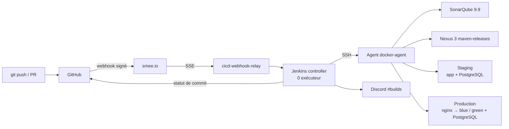

# Rapport technique — Chaîne CI/CD « Step by Step »

> TP CI/CD avec Jenkins — ESGI Master 1. Binôme : Géraldine et Morgan.
> Dépôt : `GeraldineRouy/step-by-step` (privé). Rendu du 01/11/2026.

## 1. Contexte et périmètre

L'objectif est une **chaîne CI/CD complète sous Jenkins** : chaque commit est construit, testé,
analysé, empaqueté en un artefact versionné, puis livré en staging et en production. L'application,
**Step by Step** (gestion de tâches pensée pour un profil TDA), n'est que le support de la chaîne :
elle est volontairement petite mais réelle (Spring Boot, PostgreSQL, API REST, règles métier
testées). Son API est décrite dans `docs/architecture/api.md`.

**Modules retenus (4, dont 1 de niveau 3) — règle du binôme :**

| Module | Pourquoi |
|--------|----------|
| **N1a** Qualité et retour rapide | prolonge naturellement la CI : couverture, rapports, notification, durée |
| **N1b** Releases automatisées | exploite les Conventional Commits imposés dès le premier commit |
| **N2a** Déploiement progressif blue/green | réaliste en Docker Compose local avec un reverse proxy |
| **N3b** Observabilité et DORA | niveau 3 obligatoire ; sert aussi le rapport (métriques mesurées) |

**Modules écartés :** N2b (un environnement par PR, sous-domaines, Playwright : le plus lourd) et
N3a (Terraform/Ansible : outils non installés, le plus long à construire et à maintenir). Les bonus
(feature flags, migrations expand/contract, tests de la Shared Library) n'ont pas été traités.

## 2. Architecture

Tout tourne sur une seule machine, en conteneurs Docker, ports exposés sur `127.0.0.1` uniquement.

| Composant | Rôle | Accès |
|-----------|------|-------|
| Jenkins `2.541.3-lts-jdk17` | orchestration, **0 exécuteur** sur le controller | `localhost:8080` |
| Agent `docker-agent` (SSH, image maison : JDK 17, CLI Docker et Compose, curl) | exécute **tous** les builds | interne |
| SonarQube `9.9.8-community` | analyse, Quality Gate `step-by-step-gate` | `localhost:9000` |
| Nexus `3.96.4` | dépôt `maven-releases` (redéploiement interdit) | `localhost:8081` |
| Relais `cicd-webhook-relay` (`smee-client@5.0.0`) | apporte les webhooks GitHub à Jenkins | interne |
| Staging | application + PostgreSQL 16 | `localhost:8082` |
| Production | nginx + `app-blue` / `app-green` + PostgreSQL 16 | `localhost:8088` (blue 8083, green 8084) |

### Le pipeline (`Jenkinsfile` + Shared Library `step-by-step-lib`)

| Stage | Contenu | Exigence |
|-------|---------|----------|
| Version | version du `pom.xml` + hash court du commit, ex. `0.1.0-dd4b01b` | artefact versionné |
| Checks (parallèle) | **Secrets** (`check-no-secrets.sh`), **Lint** (Checkstyle, échec sur violation), **Unit tests** (JUnit) | lint, tests unitaires |
| Integration tests | PostgreSQL jetable par build (Compose, port libre), `./mvnw verify`, couverture JaCoCo fusionnée ≥ 60 % | tests d'intégration Compose, N1a |
| Quality gate | analyse SonarQube puis `waitForQualityGate abortPipeline: true` | gate bloquante |
| Publish (`main`) | JAR + POM dans Nexus, jamais republiés | artefact publié |
| Deploy staging (`main`) | script idempotent, image construite **depuis le JAR de Nexus** | livraison continue |
| Approve production (`main`) | `input` avec `submitter: 'admin'`, 30 min max | validation manuelle |
| Deploy production (`main`) | blue/green, contrôle de santé, retour arrière automatique | N2a |
| post | notification Discord de **chaque** build | N1a |

Sur une pull request, le pipeline s'arrête après la Quality Gate : la PR reçoit le statut
`continuous-integration/jenkins/pr-merge`. Seul `main` publie et déploie.

## 3. Choix techniques argumentés

| Choix | Alternative écartée | Raison |
|-------|--------------------|--------|
| Java 17 LTS, Spring Boot 4.1 | Spring Boot 3.5 | 3.5 n'a plus de support gratuit depuis 06/2026 ; Java 17 aligné sur l'image Jenkins `jdk17` |
| Maven Wrapper (`only-script`) | Maven installé | même Maven sur le poste, l'agent et l'image |
| Agent **SSH** dédié | agent *inbound*, exécuteurs du controller | clé privée seulement dans une credential ; aucun build sur le controller |
| PostgreSQL + Flyway | H2, `ddl-auto=create` | tests d'intégration réalistes ; même schéma en test, staging et prod |
| Tests unitaires (Surefire, sans base) / d'intégration (Failsafe, avec base) | une seule famille | les unitaires restent rapides et lançables sans Docker |
| Relais **smee.io** pour le webhook | tunnel ngrok / Cloudflare, polling | un tunnel exposerait toute l'interface Jenkins ; le relais ne transmet que des webhooks **signés** (secret partagé vérifié par Jenkins) |
| Jeton GitHub *fine-grained* limité au dépôt | jeton *classic* `repo` | moindre privilège : lecture du code, écriture des statuts seulement |
| Nexus `maven-releases`, redéploiement interdit | dépôt Docker | une version publiée est immuable : la prod déploie exactement ce que le staging a validé |
| Image d'exécution construite **depuis le JAR de Nexus** | image construite depuis les sources | garantit « le même artefact » de bout en bout |
| Blue/green nginx en Compose | Kubernetes, Traefik | tient sur une machine, lisible, bascule par `nginx -s reload` |
| Shared Library dans le dépôt (`pipeline-library/`), **versionnée par tag** `lib-v*` | dépôt séparé | un seul jeton GitHub limité ; le `Jenkinsfile` épingle la version (`@Library('step-by-step-lib@lib-v1.1.1')`) |
| release-please (GitHub Actions) pour N1b | jreleaser dans Jenkins | ne demande aucun droit d'écriture GitHub à Jenkins ; PR de release relue avant publication |
| Checkstyle (20 règles ciblées) | SpotBugs, `google_checks` | règles qui attrapent de vraies erreurs sans débat de style ; SpotBugs non retenu faute de temps |

## 4. Sécurité

**Règle :** aucun secret dans un fichier, même ignoré. Les secrets vivent dans les **credentials
Jenkins** (et, pour ceux qu'un humain doit saisir, dans un gestionnaire de mots de passe).

| Secret | Où | Utilisé par |
|--------|----|-------------|
| Clé privée de l'agent | credential `docker-agent-ssh-key` | connexion SSH controller → agent |
| Jeton SonarQube | credential `sonar-token` | analyse |
| Compte Nexus de déploiement | credential `nexus-deploy-creds` | publication |
| Jeton GitHub *fine-grained* | credential `github-token` | scan Multibranch, statuts de commit |
| Secret du webhook GitHub | credential `github-webhook-secret` | vérification des signatures |
| Webhook Discord | credential `discord-webhook` | notifications |
| Comptes PostgreSQL staging / prod | credentials `staging-db-creds`, `production-db-creds` | déploiements |

**Preuves :**

- un **vigile** (`scripts/check-no-secrets.sh`) fouille l'index avant chaque commit (hook versionné
  `.githooks/pre-commit`) **et** à chaque build (stage *Secrets*), au cas où un hook local manquerait ;
- `git log -p` ne contient aucun secret (contrôle par motifs : clés privées, jetons SonarQube, GitHub,
  Jenkins) ;
- seule valeur en clair assumée : le mot de passe **de test** `test` de la base jetable des tests
  d'intégration, inaccessible hors de la machine et détruite après chaque build.

## 5. Métriques DORA

> Section complétée par Morgan (story 024) : script de calcul depuis l'API Jenkins et `git log`,
> tableau des 4 métriques, graphique Grafana, limite de l'échantillon.

## 6. Performance et fiabilité du pipeline

Mesures relevées dans Jenkins le 01/11/2026 :

| Build | Durée |
|-------|-------|
| Pull request (CI complète : checks en parallèle, intégration, analyse et gate) | **41 à 49 s** |
| `main` jusqu'à la production (CI + Nexus + staging + validation humaine + blue/green) | **≈ 2 min** |
| Webhook : push → réception par Jenkins | **≈ 1 s** ; push → début du build sur `main` : 10 s (dont 5 s d'attente volontaire de GitHub Branch Source) |

Ce qui rend le pipeline rapide :

- les **checks en parallèle** (secrets, lint, tests unitaires) ;
- le **cache Maven persistant** de l'agent (volume `jenkins_agent_m2`) ;
- la *quiet period* Jenkins ramenée à 0, car elle est inutile avec un webhook.

**Fiabilité :** chaque échec rencontré a été corrigé à la cause, pas contourné :

| Panne | Cause | Correction |
|-------|-------|------------|
| Lint en échec dans Jenkins seulement | Checkstyle 14 exige Java 21, l'agent est en Java 17 | Checkstyle 12.3.1 (testé **dans** l'agent) |
| `401` vers Nexus | mot de passe de la credential invalide (bouton *Change Password* non utilisé) | mot de passe réinitialisé ; envoi par `curl` comme le témoin de la story 004 |
| Tests d'intégration en échec sur des branches au nom long | nom du conteneur de base > 63 caractères (limite DNS) | nom court `ci-<build>-<branche>` |
| Deux builds simultanés en conflit | variable vide supprimée par Jenkins → port 5433 partagé | port `0` (Docker choisit un port libre), Shared Library `lib-v1.1.1` |
| Webhook en `405` via smee | smee retire le `/` final de la cible | cible `…/github-webhook/?source=smee` |

## 7. Écarts et compromis assumés

| Écart | Pourquoi | Ce qui le compense |
|-------|----------|--------------------|
| Relais smee.io au lieu d'un webhook direct | Jenkins est local et ne doit pas être exposé | signature HMAC vérifiée ; un webhook non signé est refusé (`400`, testé) ; scan quotidien en repli |
| Protection de `main` non appliquée par GitHub | les règles d'un dépôt **privé** exigent un compte payant | règle « branche + PR + statut ✅ » écrite dans `CONTRIBUTING.md` et respectée ; ruleset prêt, actif dès un passage à GitHub Pro |
| SonarQube Community | pas d'analyse par branche : une PR et `main` partagent le même projet | la gate reste bloquante sur chaque build |
| Shared Library dans le dépôt applicatif | voir section 3 | versions par tag, épinglées dans le `Jenkinsfile` |
| L'`input` de production garde un exécuteur de l'agent | `agent` global du pipeline | délai maximal de 30 min ; 2 exécuteurs sur l'agent |
| SpotBugs non branché | temps | Checkstyle + Quality Gate SonarQube |
| Démonstration en vidéo | consigne du 01/11/2026 : plus de démo en direct | vidéo : commit → production, puis échec volontaire bloqué |

## 8. Ce que nous avons appris

- Tester **là où le code s'exécute** : plusieurs pannes venaient d'un écart entre le poste (JDK 25,
  `localhost`) et l'agent Jenkins (JDK 17, conteneur).
- Un délai se **décompose** avant de s'optimiser : sur les 16 s du premier push mesuré, le webhook
  n'en prenait qu'une.
- Une version publiée ne se modifie jamais (Nexus, tags de la Shared Library) : on publie la suivante.
- Les règles d'équipe doivent être **écrites** quand l'outil ne peut pas les imposer.

## 9. Organisation du binôme

| Géraldine | Morgan |
|-----------|--------|
| outillage, agent, dépôt et vigile (stories 001-006) | accueil et premier lancement (story 032) |
| application, modèle, règles métier (007-009, code généré avec Claude) | première version du staging et de sa doc (015) |
| webhook, Multibranch, CI complète, Nexus (010-014) | releases automatisées N1b (023) |
| déploiement staging/prod, blue/green N2a, Shared Library (015-020) | métriques DORA N3b (024), README (025) |
| **Ensemble :** rapport, vidéo, relecture croisée des PR | |

**Usage de l'IA** (autorisé par l'énoncé « à condition de savoir l'expliquer ») : le code applicatif
a été généré directement puis vérifié (tests, relecture) ; le code CI/CD a été généré puis relu,
lancé et corrigé dans Jenkins par la personne responsable ; aucun secret n'a jamais été transmis à un
assistant. Les règles sont écrites dans `CONTRIBUTING.md`.
