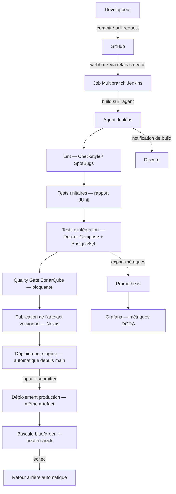

# Spécification — Projet CI/CD avec Jenkins

> TP du cours CI/CD — ESGI Master 1 « Information Architecture des Logiciels ». **Travail en binôme**
> (depuis le 01/11/2026 ; solo jusqu'à la story 010).
> Énoncé : `docs/Projet_CICD_Jenkins.pdf` (extrait texte : `docs/specification/enonce.txt`)

## 1. Contexte et objectifs

Construire une **chaîne CI/CD complète sous Jenkins** pour une application web : chaque commit est
construit, testé, analysé, empaqueté en un artefact versionné, puis livré en staging et en
production.

L'objectif pédagogique est la **chaîne elle-même** (outillage, pipeline, déploiement, modules), pas
l'application : celle-ci doit être réelle mais volontairement simple.

## 2. Périmètre retenu

### Modules choisis (4 modules, dont 1 de niveau 3)

| Module | Contenu | Pourquoi celui-là |
|--------|---------|-------------------|
| `EXG-N1a-*` | Qualité et retour rapide | Montre la boucle de feedback court exigée par le cours |
| `EXG-N1b-*` | Releases automatisées | Exploite les Conventional Commits, déjà imposés par notre convention de commits |
| `EXG-N2a-*` | Déploiement progressif blue/green | Réaliste en Docker Compose local avec un reverse proxy |
| `EXG-N3b-*` | Observabilité et DORA | Seule exigence de niveau 3 retenue, et **3 points au barème** |

### Modules écartés

| Module | Raison de l'écarter |
|--------|---------------------|
| `EXG-N2b-*` environnements éphémères | Le plus lourd : une stack Docker par pull request, sous-domaine, Playwright. Hors budget temps d'un binôme |
| `EXG-N3a-*` environnements as Code | Terraform/OpenTofu et Ansible ne sont pas installés, et ce module est le plus long à construire **et** à maintenir |

### Organisation du binôme (depuis le 01/11/2026)

Principe : **Géraldine** porte ce qui se passe **dans Jenkins** (l'instance tourne sur sa machine) ;
**Morgan** porte ce qui produit surtout **des fichiers**, testables sur sa propre copie de la stack.
Chaque PR est relue par l'autre membre : chacun doit pouvoir expliquer toute la chaîne.

| Géraldine | Morgan |
|-----------|--------|
| 001 à 014 (dont 010 à 014 : webhook, CI, intégration, gate, artefact) | 032 Accueil du binôme |
| 015 à 018 : staging, blue/green — module **N2a**, validation manuelle (repris le 01/11, voir journal) | 015 : première version du staging |
| 019 Secrets, 020 Shared Library | 023 Releases automatisées — module **N1b** |
| 021, 022 — module **N1a** | 024 Prometheus, Grafana, DORA — module **N3b** |
| | 025 README |
| **Ensemble :** 026 rapport technique, 027 vidéo de démonstration, relecture croisée des PR | |

Usage de l'IA (Claude, ChatGPT) — l'énoncé autorise les outils hors cours « à condition de savoir
les expliquer » :

| Catégorie | Fichiers | Génération par IA |
|-----------|----------|-------------------|
| Code de l'application | `src/`, tests, dépendances applicatives du `pom.xml` | ✅ générée directement, puis vérifiée (tests verts, relecture) |
| CI/CD | `Jenkinsfile`, Shared Library, `scripts/`, fichiers Compose, `Dockerfile`, nginx | 🟠 en mode guidé : chaque ligne comprise par son auteur, PR relue par l'autre membre |
| Docs et rapport | `docs/tooling/`, README, rapport | 🟡 brouillon possible, réécrit avec ses propres mots |
| Secrets | jetons, mots de passe, URL smee, credentials | ❌ jamais collés dans une IA ni dans un fichier |

## 3. Matrice de traçabilité — Exigences du TP

Les identifiants ci-dessous sont **stables** : ils seront repris tels quels dans les stories.
La colonne **Story** renvoie à `docs/stories/story-NNN-*.md`. **Statut au rendu du 01/11/2026** :
✅ fait et démontré (pipeline, vidéo ou rapport) · ⚠️ partiel, écart expliqué dans le rapport technique ·
⏳ en cours au moment du rendu · ❌ non fait ou module écarté.

### 3.1 Partie commune (obligatoire)

| ID | Exigence de l'énoncé | Story | Statut |
|----|----------------------|-------|--------|
| `EXG-COM-01` | Outillage démarré en une commande via `docker-compose.yml` | 001 | ✅ |
| `EXG-COM-02` | Jenkins, SonarQube et un dépôt d'artefacts (Nexus) | 001, 002, 003, 004 | ✅ |
| `EXG-COM-03` | Deux environnements : staging et production | 015, 017 | ✅ |
| `EXG-COM-04` | Les builds s'exécutent sur des agents, **jamais** sur le controller | 005, 011 | ✅ |
| `EXG-COM-05` | Pipeline as Code : Jenkinsfile **déclaratif** dans le dépôt de l'application | 011, 020 | ✅ |
| `EXG-COM-06` | Job **Multibranch** déclenché par webhook | 010 | ✅ |
| `EXG-COM-07` | Statut du build remonté sur les pull requests | 010 | ✅ |
| `EXG-COM-08` | Intégration continue : lint | 011 | ✅ |
| `EXG-COM-09` | Tests unitaires avec rapport **JUnit** | 009, 011, 021 | ✅ |
| `EXG-COM-10` | Tests d'intégration avec **Docker Compose** | 008, 012 | ✅ |
| `EXG-COM-11` | **Quality Gate SonarQube bloquante** | 013 | ✅ |
| `EXG-COM-12` | Artefact **versionné avec le hash du commit** | 014 | ✅ |
| `EXG-COM-13` | Artefact publié dans le dépôt d'artefacts (Nexus) | 014 | ✅ |
| `EXG-COM-14` | Livraison continue : déploiement par **script idempotent** | 015, 017 | ✅ |
| `EXG-COM-15` | Déploiement **automatique en staging** depuis `main` | 016 | ✅ |
| `EXG-COM-16` | Déploiement en **production après validation manuelle** (`input` avec `submitter`) | 018 | ✅ |
| `EXG-COM-17` | Production déployée à partir du **même artefact** que staging | 018 | ✅ |
| `EXG-COM-18` | **Shared Library versionnée par tag**, utilisée pour les étapes communes | 020 | ✅ |
| `EXG-COM-19` | Secrets **uniquement** dans les credentials Jenkins | 003, 004, 019, 025 | ✅ |

### 3.2 Module N1a — Qualité et retour rapide

| ID | Exigence de l'énoncé | Story | Statut |
|----|----------------------|-------|--------|
| `EXG-N1a-01` | Couverture de tests minimale imposée | 021 | ✅ |
| `EXG-N1a-02` | Rapports publiés dans Jenkins | 021 | ✅ |
| `EXG-N1a-03` | Notification de chaque build (Slack, Discord ou e-mail) | 021 | ✅ |
| `EXG-N1a-04` | Pipeline de **moins de 10 minutes** grâce au parallélisme et au cache | 022 | ✅ |

### 3.3 Module N1b — Releases automatisées

| ID | Exigence de l'énoncé | Story | Statut |
|----|----------------------|-------|--------|
| `EXG-N1b-01` | Conventional Commits | 006, 023 | ✅ |
| `EXG-N1b-02` | Calcul automatique de la version (semantic-release ou release-please) | 023 | ✅ |
| `EXG-N1b-03` | Changelog généré | 023 | ✅ |
| `EXG-N1b-04` | Tag Git créé | 023 | ✅ |
| `EXG-N1b-05` | Artefact versionné | 014, 023 | ✅ |
| `EXG-N1b-06` | Notes de version publiées | 023 | ✅ |

### 3.4 Module N2a — Déploiement progressif (blue/green)

| ID | Exigence de l'énoncé | Story | Statut |
|----|----------------------|-------|--------|
| `EXG-N2a-01` | Stratégie **blue/green** en production (deux instances derrière un reverse proxy) | 017 | ✅ |
| `EXG-N2a-02` | Vérification automatique de santé après bascule | 017 | ✅ |
| `EXG-N2a-03` | **Retour arrière automatique** en cas d'échec | 017 | ✅ |

### 3.5 Module N2b — Environnements éphémères

| ID | Exigence de l'énoncé | Story | Statut |
|----|----------------------|-------|--------|
| `EXG-N2b-01` | Un environnement par pull request, sous-domaine dédié | *écarté* | ❌ |
| `EXG-N2b-02` | URL de l'environnement publiée sur la PR | *écarté* | ❌ |
| `EXG-N2b-03` | Tests Playwright | *écarté* | ❌ |
| `EXG-N2b-04` | Suppression de l'environnement à la fermeture de la PR | *écarté* | ❌ |

### 3.6 Module N3a — Environnements as Code

| ID | Exigence de l'énoncé | Story | Statut |
|----|----------------------|-------|--------|
| `EXG-N3a-01` | Staging et production décrits avec Terraform ou OpenTofu | *écarté* | ❌ |
| `EXG-N3a-02` | Configuration avec Ansible | *écarté* | ❌ |
| `EXG-N3a-03` | Plan publié sur la pull request | *écarté* | ❌ |
| `EXG-N3a-04` | Plan appliqué par le pipeline après validation | *écarté* | ❌ |

### 3.7 Module N3b — Observabilité et DORA

| ID | Exigence de l'énoncé | Story | Statut |
|----|----------------------|-------|--------|
| `EXG-N3b-01` | Prometheus et Grafana | 024 | ✅ |
| `EXG-N3b-02` | Les **quatre métriques DORA** calculées automatiquement depuis Jenkins et Git | 024 | ⚠️ calcul automatisé, lancé à la main |
| `EXG-N3b-03` | Métriques suivies sur la durée du projet | 024 | ⚠️ une seule semaine mesurée |

### 3.8 Rendus attendus

| ID | Exigence de l'énoncé | Story | Statut |
|----|----------------------|-------|--------|
| `EXG-REND-01` | Dépôts Git | 006, 020 | ✅ |
| `EXG-REND-02` | `README.md` permettant de tout relancer | 025 | ⚠️ reproduction complète non rejouée |
| `EXG-REND-03` | Rapport technique : architecture, choix, métriques DORA | 026 | ✅ |
| `EXG-REND-04` | Démonstration d'un commit jusqu'à la production — **en vidéo** (consigne du 01/11/2026 : plus de démo live) | 027 | ✅ |
| `EXG-REND-05` | Échec **volontaire** bloqué par le pipeline — **en vidéo** | 013, 021, 027 | ✅ |
| `EXG-REND-06` | Capacité de **chaque membre** à expliquer l'intégralité de la chaîne | 026, 027, 032 | ✅ |
| `EXG-REND-07` | Doc qui justifie les choix et les décisions techniques (consigne du 01/11/2026) | 026 | ✅ |

### 3.9 Barème (sur 20)

| Critère | Points |
|---------|--------|
| Partie commune (outillage, pipeline CI/CD, déploiement) | 6 |
| Modules (fonctionnement et respect des consignes) | 6 |
| Fiabilité du pipeline (reproductibilité, durée, taux de succès) | 2 |
| Rapport technique et métriques DORA | 3 |
| Soutenance | 3 |

### 3.10 Bonus (non obligatoires)

| ID | Bonus | Retenu ? | Story |
|----|-------|----------|-------|
| `EXG-BON-01` | Feature flags (Unleash ou Flagsmith) | ❌ écarté | — |
| `EXG-BON-02` | Migrations expand/contract (Flyway ou Liquibase) sans interruption de service | ⏳ si temps | 030 |
| `EXG-BON-03` | Tests de la Shared Library avec JenkinsPipelineUnit | ⏳ si temps | 031 |

### 3.11 Composition de l'équipe

L'énoncé ne fixe le volume que pour un trinôme (partie commune + 4 modules dont au moins 1 de niveau
3 ) et un quadrinôme. Le travail, d'abord solo, se fait **en binôme depuis le 01/11/2026** ; la règle
donnée par le professeur pour un binôme est **partie commune + 4 modules dont au moins 1 de niveau
3** : le périmètre N1a + N1b + N2a + N3b la respecte sans changement.

## 4. Spécification de l'application web

**Nom :** **Step by Step** — gestion de tâches enrichie, cadrée pour un profil TDA

L'application est le **support** de la chaîne CI/CD, pas un second projet. Elle doit être réelle et
démontrable, mais tout code supplémentaire doit se justifier par le fait qu'il **exerce** une
exigence de l'énoncé (test, couverture, gate, déploiement).

### 4.1 Intention

Une personne qui peine à démarrer une tâche, ou à en finir une seule, dispose d'un écran qui ne lui
présente qu'**une action à la fois**, formulée en langage courant, et qui la relance au bon moment.

### 4.2 Différenciateur TDA — 3 règles structurantes

| # | Règle | Conséquence technique |
|---|-------|-----------------------|
| 1 | Une tâche se décompose en **sous-étapes de 30 minutes maximum** | Contrainte de validation sur le modèle + découpage imposé à la création |
| 2 | L'écran principal affiche **une seule sous-étape à la fois**, jamais une liste | La vue « aujourd'hui » rend exactement une sous-étape |
| 3 | Mode **une tâche par jour**, sans échéance obligatoire | Unicité sur la date planifiée ; le champ échéance reste optionnel |

S'y ajoute un **vocabulaire sans jargon** : les libellés sont des phrases courtes en langage courant
(`REG-06`), ce qui est aussi un excellent cas de test pour SonarQube et les tests JUnit.

### 4.3 Parcours utilisateur

1. Je crée une tâche (« Appeler le syndic ») avec une durée estimée.
2. L'application me demande de la **découper en sous-étapes**, et refuse une sous-étape de plus
   de 30 minutes en proposant de la redécouper (`REG-01`).
3. Je peux la placer **aujourd'hui** (`REG-02`) et choisir une **heure de rappel** (facultatif).
4. Chaque jour, je vois **une seule sous-étape** à faire, pas la liste entière (`REG-05`).
5. Je la coche : la suivante s'affiche immédiatement.
6. À l'heure choisie, je reçois le rappel sur **Discord** et une **notification dans l'application**
   (`REG-04`).

### 4.4 Modèle de données

| Entité | Champs | Contraintes |
|--------|--------|-------------|
| `Task` | `id`, `title`, `description`, `estimatedMinutes`, `plannedFor` (date, **nullable**), `reminderAt` (datetime, nullable), `status` (`TODO`, `IN_PROGRESS`, `DONE`), `createdAt`, `updatedAt` | titre 1 à 120 caractères ; au plus une tâche non terminée par `plannedFor` |
| `TaskStep` | `id`, `taskId`, `label`, `estimatedMinutes`, `position`, `done` | `estimatedMinutes` entre 1 et 30 ; `label` 1 à 80 caractères ; `position` unique par tâche |
| `NotificationLog` | `id`, `taskId`, `channel` (`DISCORD`, `IN_APP`), `sentAt`, `success` | sert de preuve pour la recette et les tests d'intégration |

### 4.5 Règles de gestion (cibles naturelles pour les tests unitaires)

| ID | Règle | Testable par |
|----|-------|--------------|
| `REG-01` | Une sous-étape dure entre 1 et 30 minutes ; au-delà, l'application invite à redécouper | test unitaire du service métier |
| `REG-02` | À une date donnée, au plus **une** tâche non terminée est planifiée | test unitaire du service métier |
| `REG-03` | Une tâche terminée est **figée** : plus aucune modification ni sous-étape | test unitaire du service métier |
| `REG-04` | Le rappel n'est envoyé que si la tâche possède au moins une sous-étape non faite | test du job planifié |
| `REG-05` | La vue « aujourd'hui » renvoie **exactement une** sous-étape (la première non faite de la tâche du jour) | test du service de vue |
| `REG-06` | Un libellé de sous-étape est une phrase courte en langage courant (1 à 80 caractères) | validation + test unitaire |
| `REG-07` | La durée totale d'une tâche est la somme des durées estimées de ses sous-étapes | test unitaire |

### 4.6 Rappels et notifications

- **Planification :** l'utilisateur choisit une date et une heure de rappel.
- **Exécution :** un job planifié dans l'application (`@Scheduled`) envoie le rappel au moment venu.
- **Canaux :** webhook **Discord** + notification **in-app** en temps réel (SSE).
- **Synergie TP :** le webhook Discord des rappels et la notification de build de `EXG-N1a-03`
  reposent sur le **même service Discord** — un seul mécanisme, deux usages, à mettre en valeur dans
  le rapport technique.

### 4.7 Stack technique de l'application

| Élément | Choix | Raison |
|---------|-------|--------|
| Langage | Java 17 LTS | Aligne le build sur l'image `jenkins/jenkins:lts-jdk17`, la plus répandue en cours ; le JDK local plus récent compile avec `<maven.compiler.release>17</maven.compiler.release>` |
| Framework | Spring Boot 4.1 (4.1.2 au démarrage) | Version maintenue (la 3.5 n'a plus de support gratuit depuis 06/2026) ; `spring-boot-maven-plugin` = artifact exécutable |
| Build | Maven (`./mvnw`) | Wrapper versionné → build reproductible sur l'agent comme en local |
| Tests | JUnit 5 + AssertJ + Mockito, `maven-failsafe-plugin` pour l'intégration | Rapports JUnit exigés par `EXG-COM-09` |
| Couverture | JaCoCo + `jacoco-maven-plugin` | Seuil minimal imposé par `EXG-N1a-01` |
| Lint / statique | Checkstyle + SpotBugs (plugins Maven) | `EXG-COM-08` sans outil propriétaire |
| Interface | **API REST JSON** (`/api/tasks`, `docs/architecture/api.md`) ; écran Thymeleaf + SSE reporté au bonus (story 028) | Un seul projet et un seul artefact : déploiement idempotent et blue/green réellement démontrables |
| Base de données | PostgreSQL dans Docker Compose | Donne un sens concret à `EXG-COM-10` ; ouvre le bonus migrations |
| Migrations | Flyway | Bonus `EXG-BON-02`, directement issu du choix de PostgreSQL |
| Image | Dockerfile multi-étapes (build + runtime JRE) | Artefact `EXG-COM-12` déployable en staging et production |

### 4.8 Fonctionnalités optionnelles (si le temps le permet)

| ID | Fonctionnalité | Raison |
|----|----------------|--------|
| `EXG-APP-OPT-01` | Minuteur Pomodoro sur la sous-étape en cours | Demandé en complément de `1c`, traité **seulement** si le périmètre principal est bouclé |

## 5. Architecture de la chaîne CI/CD

### 5.1 Composants et ports

| Composant | Rôle | Exposition hôte |
|-----------|------|-----------------|
| Jenkins controller | orchestration des pipelines | `localhost:8080` |
| Jenkins agent | exécution des builds (`Built-In Node` à 0 exécuteur) | interne |
| SonarQube | analyse qualité + Quality Gate | `localhost:9000` |
| Nexus | dépôt Maven `maven-releases` | `localhost:8081` |
| PostgreSQL de test | base jetable des tests d'intégration (`compose-test.yml`, projet `stepbystep-test`) | `localhost:5433` |
| PostgreSQL staging | base de l'environnement staging | interne au stack staging |
| Application (poste de dev) | `java -jar … --server.port=8090` ou conteneur de test | `localhost:8090` |
| Application staging | version candidate | `localhost:8082` |
| Reverse proxy (nginx) | aiguillage blue/green en production | `localhost:8088` |
| Application prod **blue** | instance stable actuelle | `localhost:8083` |
| Application prod **green** | instance candidate | `localhost:8084` |
| Prometheus | collecte des métriques | `localhost:9090` |
| Grafana | visualisation DORA | `localhost:3000` |
| Discord | rappels de tâches + notifications de build | service externe (webhook) |

### 5.2 Flux principal

### 5.3 Environnements

| Environnement | Adresse | Origine du déploiement | Déclencheur | Base de données |
|---------------|---------|------------------------|-------------|-----------------|
| staging | `localhost:8082` | artefact Nexus | push sur `main` | PostgreSQL propre au stack |
| production | `localhost:8088` (via nginx) | **le même artefact** que staging | `input` avec `submitter` | PostgreSQL propre au stack |

### 5.4 Chaîne Git

| Branche | Rôle | Comportement du pipeline |
|---------|------|--------------------------|
| `feature/*` | développement | construit et teste ; **ne déploie pas** |
| `main` | intégration | construit, teste, **déploie automatiquement en staging** |
| tag `vX.Y.Z` | version publiée | construit l'artefact versionné et le publie |

## 6. Exigences techniques détaillées

| Exigence | Mise en œuvre attendue |
|----------|------------------------|
| `EXG-COM-05` | Jenkinsfile **déclaratif** (`pipeline { agent { } stages { } post { } }`) versionné à la racine du dépôt de l'application |
| `EXG-COM-04` | `agent { label 'docker-agent' }` avec numéro d'exécuteurs explicite ; le controller est configuré à **0 exécuteur** pour que tout build passe obligatoirement par l'agent |
| `EXG-COM-06` | Plugin **GitHub Branch Source** : job de type *Multibranch Pipeline*, déclenché par webhook |
| `EXG-COM-07` | Notifications de build configurées sur le SCM, ou GitHub App : chaque PR affiche le statut du build |
| `EXG-COM-10` | Stage dédié qui démarre le stack de test via `docker compose -f src/test/resources/compose-test.yml up -d`, exécute Failsafe, puis **stoppe le stack** — avec un `post { always }` qui garantit l'arrêt même en cas d'échec |
| `EXG-COM-11` | `sonar-maven-plugin` puis appel bloquant `waitForQualityGate` : le build échoue si la gate est en échec |
| `EXG-COM-12` / `EXG-COM-13` | Version calculée `<version>-<sha-court>` puis déploiement Maven (`deploy-file`) dans le dépôt `maven-releases` de Nexus, et image Docker taguée avec le même SHA |
| `EXG-COM-14` | Script `deploy.sh` idempotent : noms de conteneurs fixes, `docker compose up -d` converge vers l'état voulu, healthcheck vérifié avant de considérer l'environnement à jour |
| `EXG-COM-16` | Directive `input { message, ok, submitter, submitterParameter }` : **seul** un compte enregistré dans `submitter` peut valider la mise en production |
| `EXG-COM-17` | Aucune reconstruction en prod : le script récupère le **même** artefact depuis Nexus par son tag |
| `EXG-COM-18` | Shared Library séparée, versionnée par tag, chargée par `@Library('cicd-shared-lib@v1.0.0')` ; les étapes communes (checkout, build, publish, deploy, notify) y vivent |
| `EXG-N1a-01` | Seuil de couverture minimal bloquant dans JaCoCo, par exemple **60 %** de lignes |
| `EXG-N1a-02` | `junit` + `jacoco` comme `post { always }`, avec `archiveArtifacts` et `publishHTML` |
| `EXG-N1a-04` | `parallel` pour lint et tests, et cache Maven entre les builds (`.m2` partagé sur l'agent) |
| `EXG-N1b-*` | `jreleaser` en stage de release : lit les Conventional Commits, calcule la version, génère changelog et notes, crée le tag, publie l'artefact |
| `EXG-N2a-*` | Reverse proxy nginx, bascule pilotée par un script, healthcheck sur `/actuator/health`, retour arrière si le check échoue |
| `EXG-N3b-*` | `spring-boot-starter-actuator` expose `/actuator/prometheus`, Prometheus scrape l'application, Grafana affiche les métriques ; les 4 métriques DORA sont calculées par un script à partir de l'API Jenkins et de `git log` |

## 7. Secrets

**Règle absolue :** aucun secret n'est écrit dans un fichier versionné. Tout passe par les
credentials Jenkins, référencés par leur identifiant dans le pipeline.

| Secret | Stockage | Consommé par |
|--------|----------|--------------|
| Mot de passe initial Jenkins | volume Docker + `docker compose exec` | toi, au premier démarrage |
| Jeton SonarQube | credentials Jenkins de type *Secret text* (`sonar-token`) | `sonar.login` |
| Identifiants Nexus | credentials Jenkins *Username/Password* (`nexus-deploy-creds`) | `withCredentials` + `deploy-file` |
| URL du webhook Discord | credentials Jenkins *Secret text* (`discord-webhook`) | notification de build **et** rappels de l'application |
| Jeton GitHub *fine-grained* (dépôt `step-by-step` seul) | credentials Jenkins *Username with password* (`github-token`) : le plugin GitHub Branch Source n'accepte que ce type | scan Multibranch et statut de PR |
| Secret partagé du webhook GitHub | credentials Jenkins *Secret text* (`github-webhook-secret`) + gestionnaire de mots de passe | vérification de signature des webhooks (*Shared secrets*) |
| URL du canal smee.io | gestionnaire de mots de passe, lue par `read -rs` | webhook GitHub, conteneur `cicd-webhook-relay`, `check-webhook.sh` |
| Mots de passe PostgreSQL staging et production | credentials Jenkins *Username/Password* | `docker compose` via variables d'environnement injectées |

Ce qui **ne** doit jamais apparaître dans le dépôt : `.env` et ses variantes, `secrets/`,
`*.pem`, `*.key`, `id_rsa*`, ainsi que toute valeur en clair dans un `docker-compose.yml`,
un `Jenkinsfile` ou un `pom.xml`.

Contrôle systématique : la section `git status` avant chaque commit fait partie des tutoriels
(`tasks-fr`), pour attraper toute fuite avant commit.

## 8. Journal des décisions

- **Décision :** périmètre des modules → **N1a + N1b + N2a + N3b** · Raison : 4 modules dont 1 de
  niveau 3 (équivalent solo de l'exigence trinôme) ; le blue/green tient en Docker Compose local et
  les métriques DORA valent 3 points au barème · Date : 02/10/2026 · Confirmée le 01/11/2026 : c'est
  aussi la règle du binôme
- **Décision :** hébergement Git → **GitHub** · Raison : webhook et statut de PR natifs, dépôt
  privé gratuit — exigence de `EXG-COM-06` et `EXG-COM-07` · Date : 02/10/2026
- **Décision :** versionnement automatique → **jreleaser** · Raison : lit les Conventional Commits et
  couvre d'un coup `EXG-N1b-01` à `EXG-N1b-06` (version, changelog, tag, notes) ; plugin Maven, donc
  cohérent avec notre stack · Date : 02/10/2026
- **Décision :** artefact publié → **image Docker + JAR dans le dépôt Maven de Nexus** · Raison :
  l'image rend le déploiement et le blue/green réalistes, le JAR prouve la publication d'un artefact
  versionné au hash du commit (`EXG-COM-12`, `EXG-COM-13`) · Date : 02/10/2026
- **Décision :** application → **gestion de tâches enrichie « Step by Step »** · Raison : le TP
  porte sur la chaîne CI/CD ; l'app doit rester un support crédible, pas un second projet · Date : 02/10/2026
- **Décision :** différenciateur TDA de l'app → **décomposition en sous-étapes de ≤ 30 min +
  affichage d'une seule sous-étape à la fois + mode une tâche par jour sans échéance obligatoire**
  (`1c`) · Raison : ce sont des règles de gestion **unitairement testables**, donc du code que
  SonarQube et les rapports JUnit peuvent réellement analyser — l'app sert ainsi aussi la chaîne ·
  Date : 02/10/2026
- **Décision :** minuteur Pomodoro → **fonctionnalité optionnelle** `EXG-APP-OPT-01` · Raison : demandé
  en complément, traité **seulement** si le périmètre principal est bouclé · Date : 02/10/2026
- **Décision :** déclenchement des rappels → **date et heure choisies par l'utilisateur**, envoi par
  un job planifié dans l'application · Raison : cas d'usage réel, et donne une horloge serveur
  exploitable pour les métriques DORA · Date : 02/10/2026
- **Décision :** canaux de notification → **Discord + in-app (SSE)** (`3a`) · Raison : Discord seul est
  fragile si la machine est éteinte ; le SSE rend la démo vivante. Le webhook Discord des rappels est
  **le même** que celui de `EXG-N1a-03` : un mécanisme, deux usages · Date : 02/10/2026
- **Décision :** interface web → **Thymeleaf + CSS léger + JavaScript natif** (`4a`) · Raison : un seul
  projet et un seul artefact, donc un déploiement idempotent (`EXG-COM-14`) et un blue/green
  (`EXG-N2a-01`) réellement démontrables. Un SPA séparerait le déploiement et menacerait le critère
  « pipeline sous 10 minutes » · Date : 02/10/2026
- **Décision :** base de données → **PostgreSQL dans Docker Compose** (`5a`) · Raison : donne un sens
  concret à `EXG-COM-10` (tests d'intégration lancés avec Docker Compose) et ouvre le bonus
  migrations `EXG-BON-02` · Date : 02/10/2026
- **Décision :** version de Java → **17 LTS** · Raison : aligne le build sur l'image
  `jenkins/jenkins:lts-jdk17`, la plus répandue dans les supports du cours ; le JDK local plus récent
  compile avec `<maven.compiler.release>17</maven.compiler.release>` · Date : 02/10/2026
- **Décision :** nom de l'application → **Step by Step** · Raison : nom court, sans espace ni
  caractères spéciaux, utilisable tel quel dans l'`artifactId` Maven, la clé de projet SonarQube et
  le dépôt Nexus · Date : 02/10/2026
- **Décision :** déclenchement du webhook GitHub vers Jenkins local → **tunnel** (Cloudflare Tunnel ou
  ngrok), et non polling (`1a`) · Raison : `EXG-COM-06` exige un webhook ; `localhost:8080` est
  injoignable depuis GitHub. Le SCM polling reste documenté comme repli, jamais comme solution
  principale · Date : 02/10/2026 · **Remplacée le 31/10/2026** (voir plus bas : relais smee.io)
- **Décision :** périmètre applicatif → **noyau minimal dans le périmètre principal, reste de
  l'application en bonus** (`2a`) · Raison : le barème porte sur la chaîne CI/CD ; garder
  l'application au strict nécessaire pour alimenter tests, couverture et gate, et poursuivre
  Step by Step (rappels SSE, Pomodoro) une fois le TP bouclé · Date : 02/10/2026
- **Décision :** Shared Library → **dépôt Git séparé** `cicd-shared-lib` (`3a`) · Raison :
  `EXG-COM-18` impose une version par tag ; un dépôt séparé rend l'invariant « pas de tag, pas de
  changement de comportement » démontrable, là où un dossier dans le dépôt applicatif l'est moins ·
  Date : 02/10/2026
- **Décision :** seuil de couverture `EXG-N1a-01` → **60 % des lignes** (`4a`) · Raison : seuil
  immédiatement discriminant dès les premières stories, paramétrable dans `pom.xml` pour être
  ajusté sans toucher au pipeline · Date : 02/10/2026
- **Décision :** découpage en stories → **27 stories sur le périmètre principal + 4 en bonus**, en
  unités de 30 minutes à une heure (`5a`) · Raison : une story = une recette vérifiable ; les
  découpages en tâches élémentaires seront produits par le skill `tasks-fr` au moment de
  l'implémentation · Date : 02/10/2026
- **Décision :** versions des images → **épinglées et vérifiées sur Docker Hub le 02/10/2026** :
  `jenkins/jenkins:2.541.3-lts-jdk17`, `sonarqube:9.9.8-community`, `sonatype/nexus3:3.96.4` · Raison :
  reproductibilité du build, exigence de fiabilité du barème. `2.541.3` est la **dernière** LTS
  Jenkins qui publie une variante `jdk17` (la LTS `2.580.1` l'a supprimée), et `9.9.8-community`
  est la dernière SonarQube acceptant Java 17 (`1a`) · Date : 02/10/2026
- **Décision :** version SonarQube → **9.9.8-community**, et non la LTA 26.5 (`6a`) · Raison :
  Community Build 26.8 a supprimé le support Java 17 (Java 21 obligatoire) ; `26.5` conviendrait mais
  pèse ~3-4 Go même plafonnée, alors qu'il ne reste que 5,3 Gio de RAM libre sur la machine · Date :
  02/10/2026
- **Décision :** mémoire des conteneurs → **plafonds JVM explicites** : Jenkins et Nexus à 512 Mio,
  SonarQube web et search à 512 Mio chacun (`2a`) · Raison : le risque numéro un sur cette machine
  est l'OOM killer ; un échec doit être « SonarQube n'a pas démarré », pas un build instable · Date :
  02/10/2026
- **Décision :** exposition des ports → **écoute sur `127.0.0.1` uniquement** (`3a`) · Raison : Jenkins
  est un contrôleur d'exécution ; le seul point d'entrée public prévu reste le tunnel de la story 010,
  lui-même protégé · Date : 02/10/2026 · Depuis le 31/10/2026, **aucun** point d'entrée public : le
  relais smee.io va chercher les webhooks depuis l'intérieur
- **Décision :** organisation des fichiers Compose → **un fichier par finalité** (`4a`) ·
  Raison : `docker-compose.yml` racine = outillage seul (Jenkins, SonarQube, Nexus, puis Prometheus et
  Grafana en story 024) ; `environments/staging/` et `environments/production/` sont autonomes, donc
  `docker compose up` ne peut pas démarrer la production par accident, et les scripts de déploiement
  idempotents (`EXG-COM-14`) restent lisibles · Date : 02/10/2026
- **Décision :** mot de passe initial Jenkins → **lu à la volée dans le volume**, jamais stocké dans un
  fichier (`5a`) · Raison : cohérent avec « aucun secret dans un fichier versionné » ; il suffit de
  `docker compose exec jenkins cat /var/jenkins_home/secrets/initialAdminPassword` · Date : 02/10/2026
- **Décision :** mots de passe admin des outils (Jenkins, SonarQube, Nexus) → **gestionnaire de mots de
  passe**, jamais dans un fichier du projet, même ignoré (`3a`, retours du 25/10/2026) · Raison :
  un `.env` ignoré reste un secret en clair sur le disque ; mots de passe initiaux lus à la volée
  (Nexus : `/nexus-data/admin.password`) · Date : 25/10/2026
- **Décision :** Quality Gate → **`step-by-step-gate`**, copie de *Sonar way* avec couverture du nouveau
  code à **60 %** (`4a`, `tasks-fr 003`) · Raison : *Sonar way* exige 80 %, incohérent avec le seuil
  `EXG-N1a-01` de 60 % · Date : 25/10/2026
- **Décision :** configuration de l'analyse SonarQube → **`pom.xml`** (plugin Maven), pas de
  `sonar-project.properties` (`1a`, `tasks-fr 003`) · Raison : le scanner Maven ignore ce fichier ·
  Date : 25/10/2026
- **Décision :** agent Jenkins → **agent SSH** `docker-agent` (image `jenkins-agent/Dockerfile` basée
  sur `jenkins/ssh-agent:8.6.0-jdk17`, CLI Docker + Compose, socket de l'hôte), clé privée
  **uniquement** dans la credential `docker-agent-ssh-key` (`1b`-`3a`, `tasks-fr 005`) · Raison : même
  règle de secrets que `nexus-deploy-creds` ; un agent *inbound* aurait exigé d'exporter son secret
  avant chaque `docker compose up` · Date : 26/10/2026
- **Décision :** interface Jenkins → **anglais forcé** par le plugin *Locale* (Manage Jenkins →
  Appearance : Default Language `English`, préférence du navigateur ignorée, pas de préférence par
  utilisateur) · Raison : les libellés correspondent mot pour mot aux tutoriels et à la doc anglaise
  (sinon « contrôleur » au lieu de `Built-In Node`) · Date : 26/10/2026
- **Décision :** dépôt Git → identité d'école en config locale, GitHub **privé** `step-by-step` en SSH
  (alias `github`), un commit par story, scan des secrets par **hook versionné**
  (`.githooks/pre-commit` → `scripts/check-no-secrets.sh`, formes connues + affectations hors
  Markdown) (`1a`-`5a`, `tasks-fr 006`) · Raison : le vigile n'oublie jamais ; le dépôt privé limite
  l'exposition d'un oubli · Date : 26/10/2026
- **Décision :** squelette applicatif → **Spring Boot 4.1.2**, Java 17 (`maven.compiler.release`),
  Maven 3.9.16 par le wrapper `only-script`, image multi-étapes `eclipse-temurin:17.0.20.1_1`
  (`jdk-noble` + `./mvnw` → `jre-noble`, utilisateur non-root), scanner `sonar-maven-plugin`
  5.8.0.7211 épinglé en `pluginManagement`, port local 8090 (`1a`-`5a`, `tasks-fr 007`) · Raison :
  version maintenue ; un seul chemin de build (poste, agent, image) ; scanner vérifié avec SonarQube
  9.9.8 et un JDK 25 · Date : 26/10/2026
- **Décision :** partage des rôles à partir de la story 007 → Claude écrit le **code applicatif**
  (classes, tests, dépendances) ; l'étudiante **décide**, écrit **tout ce qui touche à la CI/CD**
  (Sonar, Docker, scripts, Jenkins, Nexus) et fait les commits · Raison : l'objectif du TP est la
  chaîne CI/CD, l'application en est le support · Date : 26/10/2026
- **Décision :** modèle de données et base de test → schéma par **Flyway** dès la story 008
  (`V1__create_task_model.sql`, Hibernate en `validate`), base de test `postgres:16.15-alpine3.24`
  jetable (`tmpfs`, projet Compose `stepbystep-test`, `127.0.0.1:5433`), Surefire `*Test` sans base /
  Failsafe `*IT` avec base, datasource fournie par l'environnement (`SPRING_DATASOURCE_*`)
  (`1a`-`5a`, `tasks-fr 008`) · Raison : staging et prod auront le même schéma que les tests ; les
  tests unitaires restent exécutables sans Docker · Date : 29/10/2026
- **Décision :** règles métier → `REG-01` et `REG-02` dans `TaskService` (story 009), `REG-02`
  vérifiée par requête avant enregistrement (l'index unique reste le filet), messages utilisateur en
  français, code en anglais (`1a`-`5a`, `tasks-fr 009`) · Raison : testable avec Mockito sans base ;
  `REG-03` à `REG-07` restent en story 028 · Date : 29/10/2026
- **Décision :** webhook GitHub → Jenkins local → **relais smee.io** (conteneur
  `cicd-webhook-relay`, `smee-client@5.0.0`, créé par `docker run` pour ne jamais écrire l'URL dans
  un fichier), au lieu d'un tunnel ; jeton GitHub *fine-grained* limité au dépôt ; `Jenkinsfile`
  minimal (`./mvnw -B validate` sur `docker-agent`) ; PR de démonstration (`1a`-`4a`,
  `tasks-fr 010`) · Raison : un tunnel exposerait toute l'interface Jenkins à Internet, le relais ne
  transmet que les webhooks, signés par le secret partagé ; le scan quotidien reste le repli ·
  Date : 31/10/2026
- **Décision :** passage en **binôme** et rendu sans démo live → partage des stories (section
  « Organisation du binôme »), règles d'usage de l'IA par catégorie de fichiers, nouvelle story 032
  (accueil du binôme : `CONTRIBUTING.md`, protection de `main`, visite guidée), vigile des secrets
  lancé aussi par Jenkins (story 011), démonstration remplacée par **une vidéo** hors dépôt
  (story 027) et rapport technique qui justifie les choix (story 026) · Raison : consignes du cours
  modifiées le 01/11/2026 ; Jenkins reste sur la machine de l'étudiante, donc le binôme prend les
  stories qui produisent surtout des fichiers · Date : 01/11/2026
- **Décision :** rendu final avancé au **01/11/2026 à minuit** → Claude écrit aussi les fichiers CI/CD
  (Jenkinsfile, scripts, Compose, nginx, Shared Library), Géraldine les lance, configure Jenkins et
  les relit ; Géraldine reprend le déploiement (015-018) car il s'exécute sur sa machine ; Morgan
  porte N1b, N3b et le README · Raison : délai incompatible avec des tutoriels pas à pas · Date :
  01/11/2026
- **Décision :** Shared Library → **dossier `pipeline-library/` du dépôt applicatif**, versionnée par
  tags `lib-v*` et épinglée dans le `Jenkinsfile` (remplace le dépôt séparé `cicd-shared-lib`) ·
  Raison : un seul jeton GitHub limité au dépôt ; l'invariant « pas de tag, pas de changement » reste
  démontrable (`lib-v1.0.0` → `lib-v1.1.1`) · Date : 01/11/2026
- **Décision :** releases N1b → **release-please** (GitHub Actions), à la place de jreleaser ·
  Raison : aucun droit d'écriture GitHub donné à Jenkins ; la PR de release est relue avant
  publication ; la version du `pom.xml` alimente la version des artefacts Nexus · Date : 01/11/2026
- **Décision :** interface → **API REST JSON** sur `TaskService` (`/api/tasks` : lister, voir, créer,
  ajouter une sous-étape, planifier ; refus des règles en `400` avec message en français), à la place
  de l'écran Thymeleaf reporté au bonus (story 028) · Raison : l'énoncé demande une application
  **web** utilisable ; l'API rend les règles démontrables en production (vidéo) en 20 minutes de
  code testé · Date : 01/11/2026
- **Décision :** livraison → image d'exécution construite **depuis le JAR de Nexus**
  (`scripts/build-runtime-image.sh`), staging idempotent, production blue/green nginx avec retour
  arrière automatique, `input` avec `submitter: 'admin'` · Raison : « le même artefact » de bout en
  bout ; tout tient en Docker Compose sur une machine · Date : 01/11/2026

### Modules bonus

| ID | Statut | Décision |
|----|--------|----------|
| `EXG-BON-01` Feature flags | ❌ écarté | Hors budget temps ; l'adaptation TDA est déjà une fonctionnalité différenciante |
| `EXG-BON-02` Migrations expand/contract | ⏳ si temps | Directement compatible avec PostgreSQL + Flyway |
| `EXG-BON-03` Tests JenkinsPipelineUnit | ⏳ si temps | Non vu en cours ; utile pour crédibiliser la Shared Library |

## 9. Points ouverts

Tous les points structurants sont **résolus** : version de Java (17 LTS), nom de l'application
(Step by Step), seuil de couverture (60 %), périmètre du noyau applicatif, stratégie de webhook.
Il reste un seul point non bloquant, à trancher au fil de l'eau :

- `[À_VALIDER: nom du compte GitHub et du submitter autorisé en production — story 018]`
